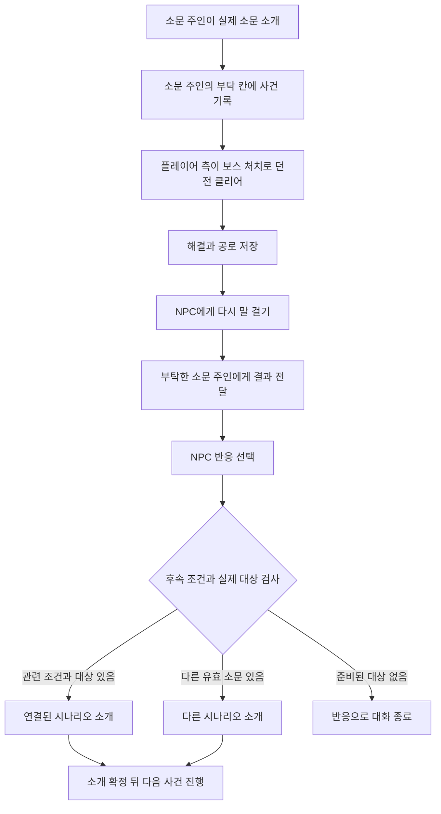

# 던전 시나리오 조립과 NPC 후속 사건 설계

> 작성일: 2026-10-05
>
> 개정일: 2026-10-09
>
> 개정(2026-10-09, 사용자 결정): 던전 안 조사(조사 지점·E키 흔적 조사·단서)를 제거했다. 던전에 들어가 조사하고 돌아오는 진행은 재미 요소가 되기 어렵다고 판단했다. 진행은 전투 결과로만 판정하고(이후 보스 처치 하나로 통일, 아래 개정), 후속 연결 조건도 결과와 반응으로만 정한다. 공통 콘텐츠 구조는 [NPC_NARRATIVE_CONTENT_DESIGN](../npc/NPC_NARRATIVE_CONTENT_DESIGN.md)을 따른다.
>
> 개정(2026-10-09, 사용자 결정): 입구 징후는 자막 한 줄(징후 사실 `sign`)로만 보여 준다. 소리·바닥 흔적 연출은 없앴고, 퀄리티를 올릴 때 다시 검토한다.
>
> 개정(2026-10-09, 사용자 결정): 부탁·보고·보답 규칙을 [NPC_NARRATIVE_CONTENT_DESIGN](../npc/NPC_NARRATIVE_CONTENT_DESIGN.md) §4.1·§4.5로 바꿨다. 소문 주인(던전 생성 때 확률로 정한 마을 주민 1명)만 부탁하고, 결과도 그 주인에게만 전한다. 주인이 반응하고 의뢰 보답을 준 뒤 `PlayerDeed` 소문으로 퍼뜨리며, 다른 NPC는 소문을 들은 뒤에만 반응한다. 고정 관계 보답과 대신 보고받는 NPC는 없다. 해결 기준은 보스 처치(던전 종료) 하나다. 원인 몬스터는 배치만 하고 source 오브젝트 연결·처치 공로 추적·진행 판정에는 쓰지 않으며, 입구 자막은 입구가 있는 동안 뜬다. 이 문서의 §1·§5·§7·§10~§12에서 이와 다른 옛 문장은 그 문서를 따른다.
>
> 개정(2026-10-10, 사용자 결정): 던전 세대에 소문 콘텐츠가 붙을 확률은 40%이고, 소문 던전은 소문 주인이 항상 있으며 일반 던전은 주인이 없다(처음에는 아무도 모르고 NPC 원정 소문으로 위치가 퍼진다). 위 2026-10-09 메모와 본문의 "확률 60%·일반 던전 포함"은 이것으로 대체한다. 소문 선정은 마을 주민이 배치된 뒤에 하고, 고를 주민이 없으면 새 주민 등록 때와 불러온 직후에 다시 고른다. 1·2단계는 2026-10-10에 [NPC_NARRATIVE_CONTENT_DESIGN](../npc/NPC_NARRATIVE_CONTENT_DESIGN.md) §8.1대로 구현했다. 이 문서가 설명하는 구 시나리오 코드(`DungeonScenarioCatalog`·`ScenarioRules`·`ScenarioReportTransaction` 등)·번들 `Scenarios.json`·시트 탭 `DungeonScenario`·`DungeonScenarioContinuation`은 같은 날 삭제했다. 본문의 클래스·파일 이름은 옛 설계 기록이고, 현재 코드 위치는 NPC_NARRATIVE_CONTENT_DESIGN §9를 따른다. 이 문서의 후속 사건(continuation) 설계는 같은 날 구현한 일반 후속 소개(NPC_NARRATIVE_CONTENT_DESIGN §4.6·§8.4)로 대체됐다. 연결 행·조건 없이, 호기심 반응을 고른 NPC가 아는 같은 마을 소문을 소개하고 그 NPC가 부탁한다.
>
> 상태: 구현 전 설계안. 클래스명, 데이터 형식, 기능 ID는 제안이다.
>
> 범위: [던전 소문 시나리오 기획](DUNGEON_RUMOR_SCENARIO_DESIGN.md)의 내부 실행 구조, 콘텐츠 조립, NPC 반응과 후속 사건 연결.

내용을 데이터로 작성하고 공통 코드가 실행하는 구조를 만든다. 지금 구현할 대상은 게임에 포함된 콘텐츠다. 사용자 모드 검색·설치, manifest·의존성 처리, 모드 화면과 배포 도구는 이번 범위에서 제외한다. 향후 다른 출처의 정의를 같은 카탈로그에 넣을 수 있도록 콘텐츠 입력 경계와 고유 ID·버전만 마련한다.

시나리오는 한 번의 사건이고, 여러 사건을 연결한 흐름은 이야기 줄기다. 사건 안에서는 소문·결과·NPC 반응을 조립한다. 사건 사이에서는 구조화된 결과와 반응을 조건으로 다음 사건을 연결한다. NPC 성격은 말투뿐 아니라 어떤 후속 이야기를 꺼낼지에도 영향을 줄 수 있다.

## 1 조립하는 데이터 단위

콘텐츠 작성자는 다음 항목을 조합한다. 모두 필수인 거대한 그래프를 직접 만드는 대신, 기본 처치·보고 흐름을 사용하고 필요한 반응과 연결 규칙을 추가한다.

| 단위 | 작성할 내용 | 늑대 소문 예시 | 공통 코드의 역할 |
|---|---|---|---|
| 발동 조건 | 어느 상황에서 소개할 수 있는가 | 유효한 입구가 발견됐고 NPC가 그 소문의 주인이며 부탁 칸이 비어 있음 | 대상·시점·NPC 지식 검증 |
| 역할과 대상 | 누가 말하며 어디에서 무엇을 해결하는가 | 소문 주인(소개한 NPC), 실제 던전 세대, 지정 Wolf | 실제 NPC·DungeonObject에 연결 |
| 징후 | 입구에서 무엇을 보는가 | "입구 안쪽에서 긴 울음소리가 들린다." | 입구 자막 표시 |
| 진행 조건 | 어떤 플레이로 결과가 성립하는가 | 던전 클리어(보스 처치) | 기존 완료 기록으로 판정 |
| NPC 반응 | 어떤 결과에 어떻게 반응하는가 | 안도, 호기심, 감탄 | 사실·성격·관계에 맞는 반응 선택 |
| 효과 | 반응이 무엇을 바꾸는가 | NPC가 결과를 알게 됨, 관계 변화·의뢰 보답, `PlayerDeed` 소문 전파 | 중복 방지와 묶음 저장 |
| 후속 연결 | 어떤 조건에서 다음 일을 꺼내는가 | 늑대 해결·클리어를 들은 호기심 많은 NPC가 슬라임 사건 소개 | 대상 준비·분기 확정·소개 기록 |

예를 들어 늑대와 슬라임 이야기는 같은 처치·보고 실행기를 쓴다. 필요한 몬스터와 징후·대사·후속 규칙만 달라진다. 새 이야기를 추가할 때 전용 System_*나 DialogueTopicType을 만들지 않는다. 새로운 행동 자체가 필요할 때만 공통 실행기와 검증 규칙을 확장한다.

## 2 늑대 시나리오를 조립하는 순서

첫째, 어떤 사실을 약속할지 정한다. 발견 단계는 "안에서 긴 울음이 들린다", 해결 단계는 "던전이 닫혀 그 울음이 멎었다"다. 원인(늑대)은 보고 대사에서 밝혀진다. 던전 전체가 안전해졌다는 효과는 넣지 않는다.

둘째, 사실을 실제 게임 대상에 연결한다. Wolf 1009를 허용하는 DungeonTable만 후보로 삼고, 최초 내부 생성 때 늑대가 실제로 배치되도록 보장한다. 특정 오브젝트를 source 역할에 연결하지 않는다(2026-10-09 개정). informant 역할은 소문 주인(소문을 실제로 소개한 NPC)에 연결한다. 역할 이름은 작성 때 정하지만 구체적인 NPC ID·던전 ID는 사건 생성과 소개 때 확정한다.

셋째, 플레이를 만드는 부품을 선택한다. 입구 울음 표시기와 처치·보고 진행 프로필을 연결한다. 처치와 클리어는 별개의 입력 신호다. 던전 안 조사 지점은 두지 않는다.

넷째, 결과를 들은 NPC의 반응을 정의한다. 호기심이 높은 NPC는 Curious, 기본 반응은 Relieved로 선택할 수 있다. 대사는 그 반응을 표현하지만 반응의 판정은 게임 데이터로 수행한다.

다섯째, 반응 이후의 연결을 정의한다. 늑대를 처치하고 클리어했으며 NPC가 호기심 반응을 보였고 실제 슬라임 사건을 소개할 수 있으면 관련 사건으로 이어진다. 그 조건이 없으면 이미 알고 있는 다른 던전 소문을 소개하거나 감사하며 끝낸다. 연결 대상이 준비되기 전에는 그 장소에 사건이 생겼다고 말하지 않는다.

이전 안에 있던 "후속 단서를 미리 심는" 단계(늑대 방의 점액 표시와 slime_trace 단서)는 조사 제거와 함께 없앴다.

## 3 정의와 실행 상태의 분리

| 층 | 내용 | 예시 |
|---|---|---|
| 시나리오 정의 | 재사용하는 내용·조건·기능 종류 | Wolf, 울음, 보고 프로필 |
| 사건 인스턴스 | 실제 세계에 연결한 대상 | 마을 12의 슬롯 0·세대 4 |
| 플레이어 진행 | 무엇을 직접 했는가 | 소문 청취, 클리어(보스 처치) |
| NPC 반응과 연결 결정 | 누가 무엇을 듣고 어느 분기를 열었는가 | NPC 321이 Curious로 반응, 슬라임 사건 소개 대기 |

같은 정의를 쓰는 던전 둘도 진행은 다르다. 한 NPC가 결과를 들었다고 모든 NPC가 원인을 알지는 않는다. 엔티티나 청크가 사라져도 사건·진행·반응 기록은 저장 데이터에 남는다.

정의와 후속 연결 규칙에는 고유 ID·revision·schemaVersion을 둔다. 내부 콘텐츠 변경 뒤에도 진행 중인 사건이 다른 이야기로 바뀌지 않도록 선정한 정의와 연결 규칙의 정규화 스냅샷을 보존한다. 스냅샷은 해시별 한 번 저장하고 사건에서 참조한다.

## 4 공통 실행기의 책임

| 제안 역할 | 책임 |
|---|---|
| DungeonScenarioDefinitionSource | 게임에 포함된 정의를 읽음. 향후 콘텐츠 입력 교체 경계 |
| DungeonScenarioValidator | 필드·기능 ID·몬스터·연결 참조 검증 |
| DungeonScenarioCatalog | 검증된 불변 정의와 적용 후보 조회 |
| IScenarioSourceBinder | 원인 몬스터의 실제 배치 보장(특정 오브젝트 연결 없음) |
| 입구 징후 표시 | 입구 엔티티의 자막(`DungeonEntranceSignView`)과 판단 시스템(`System_DungeonEntranceSign`). 입구가 있는 동안 근처에서 자막을 켬(2026-10-09 개정: 원인 상태와 무관) |
| IScenarioProgressProfile | 클리어(보스 처치)를 보고 가능한 결과로 조립 |
| ScenarioReactionResolver | 결과·NPC 성격·관계에서 반응 종류 선택 |
| ScenarioContinuationSelector | 반응과 연결 규칙에서 다음 후보 결정 |
| IScenarioTargetSelector | 후속의 실제 대상 조회 또는 생성 대기 요청 검증 |
| ScenarioFactProjector | 현재 대화 상대에게 공개 가능한 사실만 조립 |
| ScenarioReportTransaction | 보고·관계·NPC 지식·반응·연결 결정을 함께 저장 |

지속 상태는 DungeonManager와 NpcManager가 각각 자기 도메인에서 소유한다. 순수 계산인 반응 선택·후속 선택은 입력 상태를 받아 결과만 반환한다. 새 ScenarioManager가 같은 진행을 중복 소유하지 않는다. 역할별 인터페이스 등록부와 콘텐츠 카탈로그는 인스턴스가 소유하고 Reset에서 정리한다.

조건은 등록된 작은 기능을 조합한다. 예를 들어 dungeon-cleared-by-player, npc-trait-at-least, reaction-is다(player-source-kill은 2026-10-09 개정으로 없앤다). 서로 다른 시나리오가 이 기능들을 재사용하며 문자열 C# 식이나 대사를 실행하지 않는다. 첫 조건 조합은 all과 any만 지원하고 임의의 스크립트 언어를 만들지 않는다.

## 5 플레이 중 실행 순서



반복 처리는 입구 징후 표시의 갱신만 다룬다. 던전 안에 조사 입력 후보를 추가하지 않는다. 표시 갱신은 기존 [던전 스트리밍](../../Assets/Scripts/Common/System/System_DungeonStreaming.cs) 경로를 먼저 확장한다.

진행은 기존 완료 확정 경로에서 갱신한다. 월드의 모든 NPC와 시나리오를 매 프레임 순회하지 않는다. 근접 비교는 SqrMagnitude를 쓰고, 자주 사용하는 콜백은 초기화 때 만들어 재사용한다. UI와 비동기 작업의 콜백에는 사건·대화 요청·수명 식별자를 검증한다.

## 6 첫 사건의 데이터 예시

아래 JSON은 내부 콘텐츠 형식의 제안 예시다. 기능 ID·표시 에셋은 구현 때 등록하며, 아직 실행되는 콘텐츠가 아니다. 이 JSON 형식은 [NPC_NARRATIVE_CONTENT_DESIGN](../npc/NPC_NARRATIVE_CONTENT_DESIGN.md)의 행 기반 표로 대체될 예정이다.

```json
{
  "schemaVersion": 1,
  "id": "core:wolf_howl",
  "revision": 1,
  "tags": ["wolf", "sound"],
  "dungeonTableIds": [1],
  "source": {
    "type": "core:normal-monster",
    "monsterTableId": 1009
  },
  "progressProfile": "core:defeat-and-report",
  "reportPolicy": "core:first-report-relation",
  "facts": {
    "sign": "입구 안쪽에서 긴 울음소리가 들린다.",
    "cause": "던전 안의 늑대 무리가 울음의 원인이다.",
    "resolution": "던전이 닫혀 그 울음이 멎었다."
  },
  "dialogue": {
    "discovery": "{location}의 낯선 입구에서 긴 울음이 들린다더군. 살펴보면 알려주게.",
    "resolved": "그 던전이 닫혀 울음도 멎었군. 늑대 무리 때문이었다고?"
  },
  "reactions": [
    {
      "id": "curious_after_clear",
      "on": "core:outcome-reported",
      "all": [
        {"type": "core:dungeon-cleared-by-player"},
        {"type": "core:npc-trait-at-least", "trait": "curiosity", "value": 70}
      ],
      "kind": "Curious",
      "priority": 20,
      "text": "그 동굴의 일은 끝났군. 안에서 있었던 일이 궁금하네."
    },
    {
      "id": "default_relief",
      "on": "core:outcome-reported",
      "all": [],
      "kind": "Relieved",
      "priority": 0,
      "text": "돌아왔군. 소식을 전해줘서 고맙네."
    }
  ]
}
```

이전 안에 있던 evidence(조사 지점), cues의 조사 지점 점액 표시, facts의 slime_trace 단서, dialogue.confirmed는 조사 제거로 없앴다. 입구 소리 연출(cues)도 2026-10-09에 없앴고, facts.sign을 입구 자막으로 함께 쓴다. 원인(facts.cause)은 보고 대사에서 밝혀진다. 해결이 보스 처치 하나라 보고 대사도 resolved 하나이고 closed는 없앴다(2026-10-09 개정).

## 7 NPC 반응을 다음 사건의 입력으로 사용

NPC 반응은 표시 문장과 별개의 구조화된 결과다. 첫 반응 종류는 Relieved·Curious·Impressed·Concerned로 잡는다. 말투만 다른 감사는 같은 종류를 쓰고, 후속을 달리할 때 필요한 구분만 추가한다.

| NpcReactionResult의 제안 필드 | 의미 |
|---|---|
| EventId | 같은 반응을 다시 처리하지 않는 식별자 |
| StoryRootId·EpisodeId | 어느 이야기와 사건에서 나온 반응인가 |
| NpcId·ReactionRuleId·Kind | 누가 어떤 규칙으로 어떻게 반응했는가 |
| ReportedFacts | 이번에 실제 전달된 해결·공로 |
| OutcomeRevision | 어떤 진행 결과에 대한 반응인가 |

반응 선택은 현재 보고 결과와 NPC 성격·관계를 입력으로 받는다. 성격은 후속 이야기를 꺼내는 조건에 영향을 주며 사실의 성립 여부를 바꾸지 않는다. 조건을 통과한 반응 규칙의 priority가 높은 것을 선택하고 동률은 규칙 ID 순서로 결정한다. 관계 조건은 이번 반응을 반영하기 전의 관계로 검사한다([NPC_NARRATIVE_CONTENT_DESIGN](../npc/NPC_NARRATIVE_CONTENT_DESIGN.md) §4.3). 관계 변화는 실패 시 보고와 함께 되돌린다.

예를 들어 슬라임 사건으로 이어지는 후속은 Curious 반응이면서 ReportedFacts에 늑대 소문의 해결(보스 처치)이 있어야 한다. LLM이 "더 궁금하군"이라는 문장을 썼다는 이유로 Curious를 판정하지 않는다. LLM은 이미 선택한 반응과 사실을 표현한다.

보고 작업 중 반응과 후속 후보를 계산하고, 확정 결과를 같은 저장 트랜잭션에 넣는다. 성공 뒤 NpcReactionCommitted라는 구조화된 이벤트를 발행할 수 있다. 시나리오 연결은 저장된 결정에 따르며 이벤트 재전달로 다시 추첨하거나 사건을 중복 생성하지 않는다. 추후 다른 도메인의 반응 구독도 이 이벤트 ID로 중복을 막는다.

EventId는 사건·NPC·보고 단계·OutcomeRevision·반응 규칙의 안정적인 식별 조합으로 만든다. 대화를 연 시각이나 새 임의 난수를 ID로 쓰지 않아 저장 재시도에서도 같은 의미의 반응을 구분할 수 있다.

## 8 후속 연결 규칙의 데이터 예시

연결은 시나리오 본문에 하드코딩하지 않고 독립된 규칙으로 둔다. 작성자는 "이 반응과 이 사실이 있을 때 이 사건을 소개한다"를 추가한다. 기존 시나리오 실행기는 그대로 사용한다.

```json
{
  "schemaVersion": 1,
  "id": "core:wolf_followups",
  "revision": 1,
  "sourceScenarioId": "core:wolf_howl",
  "on": "core:npc-reaction-committed",
  "rules": [
    {
      "id": "slime_connection",
      "priority": 30,
      "all": [
        {"type": "core:reaction-is", "value": "Curious"},
        {"type": "core:dungeon-cleared-by-player"}
      ],
      "target": {
        "mode": "core:reveal-existing",
        "scenarioIds": ["core:slime_trail"],
        "scope": "sameVillage",
        "knowledge": "knownToSpeaker"
      },
      "bridgeText": "그러고 보니 {targetLocation} 입구에도 수상한 흔적이 있다더군. 그쪽도 살펴보겠나?",
      "maxUsesPerRoot": 1,
      "onUnavailable": "tryNextRule"
    },
    {
      "id": "another_known_rumor",
      "priority": 10,
      "all": [
        {"type": "core:dungeon-cleared-by-player"}
      ],
      "target": {
        "mode": "core:reveal-existing",
        "scenarioIds": ["core:stone_scraping"],
        "scope": "sameVillage",
        "knowledge": "knownToSpeaker"
      },
      "bridgeText": "돌 긁는 소리가 들리는 {targetLocation}의 다른 입구 소식도 있네. 관심이 있다면 확인해 보게.",
      "maxUsesPerRoot": 1,
      "onUnavailable": "endConversation"
    }
  ]
}
```

여기서 core:slime_trail과 core:stone_scraping은 상위 기획의 슬라임·돌 소리 정의를 가리킨다. 실제 소개 대상은 그 정의를 사용하는 현재 유효한 사건 중에서 고른다. 정의 이름만 있다고 세계에 새 던전이나 소문을 만들어 내지 않는다.

첫 규칙이 성립하면 관련 이야기로, 그렇지 않으면 두 번째 규칙으로 간다. 두 번째도 소개할 대상이 없으면 NPC 반응으로 끝난다. 끝나는 것도 정상 분기다. 한 번의 반응에서 다음 사건 하나만 선택하며 선택한 규칙과 대상은 저장한다.

이 연결의 결과 조건(dungeon-cleared-by-player)은 이번 반응의 ReportedFacts를 검사한다. NPC에게 전달하지 않은 결과를 후속 소개의 근거로 쓰지 않는다. bridgeText는 검증된 대상이 있는 경우에만 사용하고, {targetLocation}도 그 실제 입구에서 계산한다.

## 9 같은 사건과 다른 사건을 연결하는 방식

| 방식 | 연결 대상 | 예시 | 제약 |
|---|---|---|---|
| ContinueCurrent | 같은 사건의 아직 가능한 단계 | (보류) 조사 제거로 첫 예시였던 "원인 확인 뒤 제거 권유"가 없어짐 | 던전이 접근 가능하고 단계가 미완료여야 함 |
| RevealExisting | 실제로 존재하는 다른 사건 | 늑대 해결 뒤 다른 입구의 슬라임 소문 연결 | 대상 유효·입구 존재·NPC 지식·미완료 검사 |
| PrepareFollowup | 정의한 후속 사건을 준비할 요청 | 다음 미선정 던전 세대에 늑대 흔적 후속 준비 | 이미 고정된 던전을 덮어쓰지 않음. 준비 전 위치 소개 금지 |

첫 연결 플레이 예시는 RevealExisting으로 만든다. ContinueCurrent는 조사 제거로 첫 사용처가 없어져 첫 구현에서 쓰지 않는다. **사용자 확정 2026-10-06:** 우선 후속 연결이 가능한 구조를 마련하고 발생 빈도·보장 정책은 나중에 보강한다. PrepareFollowup은 확장 경계로 두고 실제 예약·새 사건 준비는 후속 범위다. 처음부터 전역 이벤트 디렉터나 새 던전 생성 규칙 전체를 만들지 않는다.

후속 대상 선택기는 실제 후보를 반환한다. 같은 마을, 접근 가능한 입구, 지원되는 정의, NPC의 유효 지식, 플레이어 미완료 여부, 원래 사건과 다른 대상인지 확인한다. NPC는 알고 있지 않은 사건을 소개하지 않는다. 다른 NPC가 알고 있다는 정보 자체를 이용하려면 실제 그 NPC와 관계·지식 출처도 검증해야 한다.

첫 RevealExisting은 플레이어가 아직 소개받거나 방문하지 않은 사건을 대상으로 한다. 같은 대상을 여러 후속에서 동시에 예약하지 않는다. 연결은 이미 존재하는 세계 사건에 이야기의 부모·자식 관계를 붙이는 것이며, 그 던전의 정의·몬스터·원인을 교체하거나 사건 정본을 복제하지 않는다. 이미 진행 중인 사건에 대한 회고·연관 정보는 새 자식 생성과 구분하는 후속 확장이다.

동일 우선순위의 여러 후보는 사건 ID 순으로 고르고, 여러 내용을 무작위로 고르는 기능이 필요하면 StoryRootId·반응 EventId·규칙 ID의 전용 시드를 사용한다. 선택을 저장하며 대화를 다시 열어 추첨을 반복하지 않는다. 소개 대기 중 대상이 종료되면 그 소개를 취소하고 현재 사실에 맞게 말한다. 취소된 연결을 같은 반응으로 무한 재선정하지 않는다.

## 10 다시 말 걸었을 때의 대화 흐름

사용자의 예시처럼 클리어 후 NPC에게 다시 말 걸면 이전 사건의 결과 이야기를 우선 제시한다. 클리어 순간 NPC가 자동으로 모든 내용을 알지는 않는다. 대화에서 플레이어의 짧은 보고 문장을 먼저 보여주고 그 NPC가 내용을 받은 것으로 처리한다.

| 플레이 상태 | 전달 가능한 내용 | NPC와 후속의 제한 |
|---|---|---|
| 보스를 처치해 클리어 | 해결 | 관련 사건(슬라임) 연결 가능 |
| 늑대만 처치하고 미클리어 귀환 | 없음(미해결) | 진행 확인 대사만 나옴(2026-10-09 개정) |

예전에 이 NPC가 실제로 소개한 사건의 미보고 결과가 있을 때 자동 후보로 잡는다. 다른 마을·관계 없는 사건의 결과를 무작정 자동 전달하지 않는다. 결과는 소문 주인에게만 전한다. 주인이 죽으면 보고 없이 끝나고, 다른 NPC는 주인이 퍼뜨린 `PlayerDeed` 소문을 들은 뒤에만 반응한다(2026-10-09 개정).

첫 UI는 "플레이어의 보고 → NPC 반응 → 후속 소개 또는 종료" 순서로 짧게 보여준다. 관계 변화·의뢰 보답은 일반 Talk의 +1과 중복 호출하지 않는다.

NPC별 미보고 결과 하나를 한 대화에서 처리하고, 후속 소개도 하나만 제시한다. 같은 결과를 다시 말하면 짧은 회고로 바뀌며 보답·반응 이벤트·새 연결을 다시 발생시키지 않는다. 보고는 사건당 한 번이다. 해결을 보고한 뒤의 클리어는 다시 보고하지 않고 동행 소문으로만 퍼진다(2026-10-09 개정).

## 11 분기 저장과 반복 방지

보고 트랜잭션은 다음을 함께 준비한다.

1. 보고 가능한 사실과 행위자 공로를 다시 검증한다.
2. NPC가 알게 된 사실, 보고 단계, 관계 변화·의뢰 보답, 부탁 칸 비우기·`PlayerDeed` 소문을 임시 반영한다.
3. 반응 규칙을 선택하고 후속 대상과 소개 대기를 검증한다.
4. 반응 EventId, 연결 결정, 중복 방지 표시를 준비한다.
5. Dungeons·Player와 변경된 NPC 파티션을 같은 manifest revision으로 커밋한다.
6. 성공한 내용을 표시하고, 실패하면 변경을 함께 되돌린다.

대사 생성은 검증된 반응·대상·공개 사실을 받아 수행한다. LLM 실패는 기본 대사로 대체한다. 보고가 저장됐으나 화면 표시가 실패하면 같은 저장 결과를 다시 표시하고 게임 효과를 다시 적용하지 않는다. 후속의 청취·소개 완료는 실제 해당 대사가 표시됐을 때 기록한다.

중복 처리 키는 EpisodeId·NpcId·보고 단계·OutcomeRevision으로 잡는다. 같은 사실만 반복한 보고로 revision을 올리지 않는다. 연결 규칙의 maxUsesPerRoot는 이야기 줄기 전체에서 검사한다. A에서 B를 소개하고 B가 다시 A를 소개하는 데이터는 같은 대상 재방문·완료 조건과 사용 횟수로 차단한다.

한 NPC에게는 후속 소개 대기 하나만 둔다. 대기 중 새 반응이 생기면 현재 대기를 덮어쓰지 않고 새 연결을 억제하며, 이번 반응에는 후속 소개 약속을 하지 않는다. 무한 대기 목록이나 모든 NPC의 정기 재평가를 만들지 않는다. 새 사건 준비 요청의 재시도는 입구 배치·NPC 귀환 같은 실제 상태 전환에 연결한다.

## 12 저장 소유와 정리

| 데이터 | 소유 위치 | 남겨야 할 내용 |
|---|---|---|
| 불변 정의·연결 카탈로그 | DataManager 소유 인스턴스 | ID·버전·검증된 기능과 규칙 |
| 원인 | DungeonSlot·DungeonRecord | 해당 세대·원인 몬스터 배치(특정 ID 없음) |
| 플레이어 진행 | Dungeons 파티션 | 청취·행위 공로·보고 단계 |
| 반응과 연결 결정 | Dungeons의 이야기 기록 | NPC ID·EventId·규칙·대상·사용 횟수·표시 대기 |
| NPC 지식·소문 | NpcManager와 NPC 저장 | 실제 받은 사실·출처. 사건의 정본 사본은 없음 |
| 관계 | 기존 Player 파티션 | 기존 관계 수치와 상한 |

현재 플레이어 한 명의 구조를 전제로 한다. 해결은 기존 완료 기록의 플레이어 측 보스 처치(`BossKilledByPlayerParty`)로 판정하고 같은 의미의 bool을 중복 저장하지 않는다(2026-10-09 개정). **사용자 확정 2026-10-06:** 유효한 동행 NPC의 처치도 플레이어의 처치로 인정한다. 동행이 혼자 보스를 마무리해도 동일하게 진행·보고·보답·후속 조건에 반영한다. 원인 몬스터의 처치 공로는 진행에 쓰지 않으므로 따로 수집하지 않는다.

완료된 던전의 구조는 기존 퇴장 규칙대로 삭제한다. 최신 종료 사건 하나라는 기존 기본안은 유지하되, 아직 진행 중인 이야기 줄기가 참조하는 부모 사건의 작은 요약은 이야기 기록에서 보존한다. 다음 세대가 종료됐다는 이유로 이미 열린 후속의 결과·반응·출처를 잃지 않는다. 전체 DungeonRecord를 붙잡아 두지는 않는다.

이야기 기록은 StoryRootId·ParentEpisodeId·부모 사실 요약·연결 결정과 필요한 정의 해시를 가진다. 활성 사건·소개 대기·생성 대기·미보고 결과가 없으면 줄기를 종료하고 정리할 수 있다. 반응으로 끝난 옛 사건의 중복 방지 표시는 그 사건을 더 이상 보고할 수 없는 시점에 함께 정리한다. 참조되지 않는 정의 스냅샷도 정리한다.

NPC 지식은 사건 ID·공개 사실 키·출처를 참조하고 전체 사실 문장을 복사하지 않는다. 사건 정리 시 관련 지식 참조도 정리한다. 기존 유효 DungeonInfo로 처음 소개할 수 있는 사실과 보고로 새로 받은 종료 결과의 지식을 구분하며, 종료 사건의 부탁을 다시 유효 소문으로 만들지 않는다.

NPC 사망·이주 시 소개 대기는 유효성을 재검사한다. 개인에게 귀속된 후속을 임의의 다른 NPC에게 옮기지 않는다. 지역 소문으로 대체 전달할 수 있다고 작성된 연결만 적합한 생존 NPC에게 넘기고 출처를 남긴다. 부모 사건의 결과 보고는 부탁한 소문 주인에게만 하며 대신 보고받는 NPC는 없다(2026-10-09 개정).

## 13 나중에 콘텐츠 입력을 확장하는 경계

이번 구현에서 필요한 경계는 정의 입력, 등록된 기능, 고유 ID 세 가지다. 기본 정의 공급자는 게임에 포함된 JSON을 읽어 불변 카탈로그로 넘긴다. 향후 사용자 콘텐츠 공급자를 추가하더라도 처치·반응·연결 실행기는 같은 검증된 정의를 받도록 한다.

내부 ID는 core:wolf_howl처럼 출처와 지역 이름을 분리하고, 저장에는 표시명이 아닌 ID와 정의 해시를 쓴다. 조건·목표·표시·후속 선택 기능은 이름으로 등록하되 실제 실행 인스턴스는 초기화 때 연결한다. 알 수 없는 기능과 참조는 오류로 보고 조용히 다른 이야기로 바꾸지 않는다.

이 경계를 준비하는 것이 현재 작업의 확장성이다. 모드 폴더, 팩 의존성, 활성화 UI, 외부 에셋 로딩은 구현 완료 조건에 넣지 않는다. 작성용 예시와 개발 진단은 기본 콘텐츠를 정확하게 조립하기 위해 제공한다.

## 14 구현 순서와 검증

| 단계 | 작업 | 완료 조건 |
|---|---|---|
| 1 내부 데이터 기반 | 정의·연결 DTO·검증·카탈로그·기능 등록 | 게임 내 세 시나리오를 같은 형식으로 읽음 |
| 2 사건 하나의 공통 실행 | 원인 연결·징후·진행·기본 대사 | LLM 없이 소문부터 해결까지 플레이 |
| 3 결과와 NPC 반응 | 보고·공로·지식·관계·반응·저장 | 클리어 후 다시 말 걸면 사실에 맞게 반응 |
| 4 짧은 사건 연결 | 늑대 해결 뒤 슬라임 연결·다른 소문·종료 규칙 | 조건별로 후속 하나를 열고 재접속에도 동일 |
| 5 콘텐츠 추가와 품질 | 돌·늑대·슬라임, 기본 대사·성격별 반응·캐시·진단 | 기존 실행기 수정 없이 다른 정의·연결 규칙으로 변형 |

선정·입구·NPC 전달·보고의 저장 경계와 구 세이브 이관은 [상위 기획](DUNGEON_RUMOR_SCENARIO_DESIGN.md)을 따른다. 저장 변경 그룹·dirty 표시·트랜잭션 되돌리기와 [세이브 파티션](../tech/SAVE_PARTITION_DESIGN.md)·[스냅샷](../tech/SAVE_SNAPSHOT_DESIGN.md) 검증도 함께 확장한다.

기존 [DungeonRuntimeDiagnostics](../../Assets/Scripts/Editor/DungeonRuntimeDiagnostics.cs), [NpcAmbitionSimDiagnostics](../../Assets/Scripts/Editor/NpcAmbitionSimDiagnostics.cs), [NpcSaveSnapshotDiagnostics](../../Assets/Scripts/Editor/NpcSaveSnapshotDiagnostics.cs)에 다음 검증을 연결한다.

- 지정 처치·보스 클리어·NPC 완료를 서로 다른 사실로 기록한다.
- 관련 연결은 늑대 해결·클리어·반응 조건이 모두 맞을 때만 열리며 클리어만으로 열리지 않는다.
- 같은 NPC·결과의 반복 대화, 저장 실패·재시도·이벤트 재전달에서 보답과 연결이 중복되지 않는다.
- 반응으로 끝남, 관련 사건 연결, 다른 사건 연결이 모두 정상 동작한다.
- 부모 던전 삭제·최신 종료 사건 교체 후에도 활성 후속의 출처와 사실을 복원한다.
- 후속 입구 없음·종료·미지원 정의·NPC의 지식 없음은 허위 소개를 만들지 않는다.
- NPC 사망·이주·UI 표시 실패·다른 NPC 보고에 따른 대기를 처리한다.
- 같은 정의·사실·상태에서 같은 반응과 후속을 선택하고 캐시는 공개 단계·반응 EventId·후속 대상에 맞게 갱신한다.
- 기존 소문 상한·대상별 하나·전파·유망 판정과 구 던전 구조 복원을 유지한다.
- 새로운 이야기와 연결 규칙을 데이터로 추가하고 처치·NPC 대화 실행기를 수정하지 않는다.

## 15 인접 시스템과의 경계

이번 후속 연결은 로컬 사건의 이야기 흐름이다. [WORLD_EVENT_DESIGN](../world_history/WORLD_EVENT_DESIGN.md)의 전역 위협·시간 압박·발화 디렉터를 구현한 것으로 취급하지 않는다. 추후 전역 사건 실행기가 준비되면 구조화된 NPC 반응에서 시작 요청을 전달하는 어댑터를 붙일 수 있다.

NPC의 깊은 개인 소망은 [QUEST_SYSTEM_DESIGN](../npc/QUEST_SYSTEM_DESIGN.md)의 대상·관계 문턱·목표·보상 계약을 따른다. 던전 후일담을 NpcWish에 임의로 넣거나 소망 완료를 대사로 판정하지 않는다. 첫 처치·보고 흐름과 간단한 후속 연결은 소망 전체 구현을 기다리지 않고 동작하게 만든다.

대사 생성의 사실과 관점 분리는 [내러티브 설계](../world_history/NARRATIVE_ENGINE_DESIGN.md)를 따른다. NPC의 반응과 다음 사건은 게임이 선택하고 LLM은 그 선택을 표현한다. 감사 문장 하나가 자동으로 새로운 동굴·구출 대상·보상을 만들어 내는 경로는 두지 않는다.

## 16 구현 전 코드 점검과 남은 계약

2026-10-06의 정적 코드 점검 결과다. 아래 항목은 구현·플레이 검증을 완료했다는 의미가 아니다. 구조를 다시 설계하기보다, 연결 지점과 판정 계약을 구현 전에 구체화할 항목으로 기록한다.

### 후속을 만나는 빈도

첫 RevealExisting은 다른 미진행 사건, 실제 입구, NPC 지식, 반응 조건이 함께 있어야 한다. 해결과 클리어까지 필요한 관련 연결은 더 제한된다. 기획이 올바르게 동작해도 평소 플레이에서 후속을 거의 못 볼 수 있다. 입구 배치는 [DungeonSettings](../../Assets/Resources/DungeonSettings.json)의 ApproachDistance 64와 [입구 배치 경로](../../Assets/Scripts/Dungeon/DungeonManager_Entrances.cs)를 따르므로 후속의 논리 입구가 아직 없을 수도 있다.

**사용자 확정 2026-10-06:** 첫 구현은 후속 연결이 가능한 구조와 조건별 동작을 마련한다. 조건이 맞으면 연결하고 없으면 정상 종료한다. 진단에서는 실제 대상·지식·성격을 갖춘 격리된 사례로 연결을 검증한다. 평소 발생 빈도 조정·빈도 계측·항상 이어지는 이야기의 예약 기능은 나중에 보강한다. PrepareFollowup과 다음 미선정 세대 예약의 실제 동작은 현재 완료 조건에 포함하지 않는다.

### 처치 공로의 수집

[System_HpCheck](../../Assets/Scripts/Common/System/System_HpCheck.cs)는 DungeonManager.HandleDeath에 피해자 ID만 넘기고 DeathMessage.KillerEntityId도 0으로 보낸다. [DamageCalculator](../../Assets/Scripts/Skill/Combat/DamageCalculator.cs)는 공격자 ID를 알지만 현재 사망 확정까지 연결하지 않는다. [System_BuffUpdate](../../Assets/Scripts/Common/System/System_BuffUpdate.cs)의 지속 피해는 공격자를 -1로 보내며 [BuffInstance](../../Assets/Scripts/Common/Component/BuffInstance.cs)에 적용자의 정보가 없다.

**사용자 확정 2026-10-06:** 플레이어와 유효한 동행의 처치는 모두 같은 플레이어 공로로 정규화한다. 동행이 마무리했거나 플레이어의 직접 공격 없이 처치해도 인정한다. 토템·소환물은 [CasterLinkComponent](../../Assets/Scripts/Common/Component/CasterLinkComponent.cs)로 원 시전자를 해석하고, 지속 피해와 반사도 발생 원인과 귀속 정보를 전달한다. 이러한 공격 종류의 추적은 확정한 공로 규칙을 적용하기 위한 구현 사항이다. 이미 HP가 0인 대상의 추가 피해나 UI 갱신 메시지는 확정된 사망 원인을 덮어쓰지 않는다.

**2026-10-09 개정:** 해결이 보스 처치 하나가 되어 원인 몬스터의 처치 공로는 수집하지 않는다. 보스 처치 공로는 기존 완료 경로(`BossKilledByPlayerParty`)를 쓰며, 동행 이외의 NPC가 독립적으로 한 처치를 플레이어 공로로 만들지 않는다.

### 보고와 비동기 대화

[UINpcInspect.OnClickTalkAsync](../../Assets/Scripts/UI/UINpcInspect.cs)는 대화 시작 때 일반 Talk를 적용하고, await 이후에도 현재 _entityId와 화면 필드를 사용한다. [InteractionHelper](../../Assets/Scripts/Common/Utility/InteractionHelper.cs)의 Talk는 호감도·친밀도 각각 +1을 즉시 반영한다.

보고 후보와 소개 대기를 먼저 판별한 뒤 일반 대화·시나리오 보고 중 하나의 처리 경로를 고른다. 같은 NPC의 보고 연속 클릭은 진행 중인 작업 하나로 제한한다. NPC ID·보고 결과 revision·UI 바인딩 버전·요청 ID를 캡처하고, 비동기 응답 시 여전히 같은 대화인지 확인한다. 다른 NPC를 열거나 닫은 화면에 이전 대사를 표시하지 않는다. 이미 커밋된 결과는 취소된 표시와 구분하고 재표시하며 보답을 다시 적용하지 않는다.

### 저장 DTO와 캐시의 확장

[DataManager_SaveSnapshot.CaptureOwnedDungeons](../../Assets/Scripts/Manager/DataManager_SaveSnapshot.cs)는 현재 DungeonRecord와 VillageDungeonSlots를 키로 조립하고 루트에는 Version·CompletedCount를 반영한다. [DungeonSaveGroup](../../Assets/Scripts/Data/SaveSnapshotGroups.cs)은 기존 Identity·Layout·Progress·Monsters·Drops·Tiles 그룹이다. 새 이야기·반응·정의 목록을 DTO에만 추가하면 기존 캐시 조립 경로에는 실제 내용이 들어가지 않는다.

새 원장의 키·조회·목록 조립·변경 그룹·추가와 삭제·동결·Reset 경로를 함께 확장한다. 보고의 관계·지식·분기 묶음 저장과 실패 되돌리기뿐 아니라 변경 없는 저장, 부모 구조 삭제 후 저장, 두 번째 저장·로드에서 동일 진행인지까지 검사한다. 버전 이관은 던전 저장 형식·월드 버전·레이아웃 생성기 버전의 변경 책임을 구분하고, 구 방문 던전을 다시 생성하지 않는다.

### 종료 사건과 소문의 구분

[NpcManager.IsRumorValid](../../Assets/Scripts/Manager/NpcManager_Rumor.cs)는 DungeonInfo의 세대가 현재 슬롯과 같아야 유효하다고 판정한다. 완료 시에는 다음 세대로 전진하고 [던전 퇴장](../../Assets/Scripts/Dungeon/DungeonManager.cs)에서는 완료된 DungeonRecord를 삭제한다.

클리어 후 보고 대상은 유효한 현재 소문에서 찾지 않고 저장된 소문 주인(부탁 칸)·사건 진행·종료 요약에서 찾는다. 다음 사건의 발견 소문에는 기존 세대 검증을 그대로 적용한다. 옛 결과를 보고하려고 IsRumorValid를 완화하지 않는다. 최신 종료 요약 교체와 NPC 사망·이주에서도 활성 줄기의 필요한 부모 사실을 보존한다.

### 징후 표현

던전 안 조사 후보는 만들지 않는다(2026-10-09 조사 제거). 이전 안의 조사 후보 동률 규칙과 입력 가로채기 검사는 필요 없다.

입구 징후는 자막만 쓴다(2026-10-09 사용자 결정). 소리·흔적 에셋은 퀄리티를 올릴 때 다시 검토한다. 자막은 청크 해제·던전 입장·Reset 뒤에 남지 않게 하고, 원인 몬스터를 잡아도 끄지 않는다(2026-10-09 개정).

### 대화의 사실 범위

[NpcNarrativeService](../../Assets/Scripts/Npc/Narrative/NpcNarrativeService.cs)는 현재 전체 문맥의 ToPromptText와 주제 suffix를 함께 전달한다. 시나리오에서는 공개 단계·보고 사실·NPC 지식·선택된 후속만 포함하도록 입력을 분리한다. 단계 변경과 후속 취소 시 캐시도 무효화한다. LLM 없이 기본 문장만으로 소개·해결·반응·후속 흐름이 완성되는지 먼저 검증한다.

후속은 가능한 구조부터 구현하고 빈도 보강은 미루며, 동행 처치는 플레이어 공로로 인정하는 것으로 사용자 결정이 확정됐다. 이 절의 나머지는 추가 기획 결정 없이 위 연결 지점을 구현하고 기존 진단에서 검증할 기술 사항이다. 처음에는 늑대 하나의 처치·클리어·보고·관련 연결·다른 소문·종료를 끝까지 만들고 저장 실패·재접속을 확인한 뒤 콘텐츠 종류를 늘린다.
