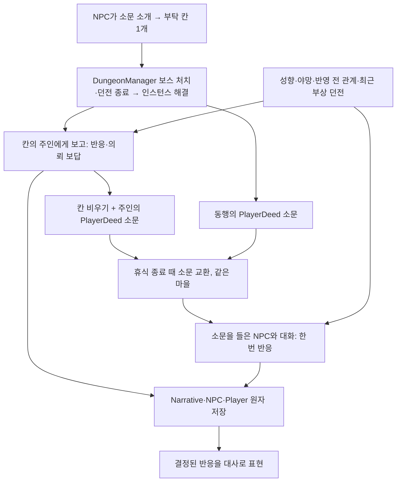

# NPC 대화 콘텐츠 공통 구조와 테이블 작성 설계

> 작성일: 2026-10-07
>
> 개정일: 2026-10-09
>
> 개정: 공통 실행 기록을 NarrativeSaveRoot로 분리하고 저장·이관 계약 반영.
>
> 개정(2026-10-09, 사용자 결정): 던전 안 조사(흔적 조사 지점·E키 흔적 조사·단서)를 제거한다. 던전에 들어가 조사하고 돌아오는 진행은 재미 요소가 되기 어렵다고 판단했다. 던전 소문의 진행은 전투 결과로만 판정하며(이후 보스 처치 하나로 통일했다, 아래 개정), 보류였던 NarrativeObservation은 두지 않는다.
>
> 개정(2026-10-09, 사용자 결정): 구 시나리오 저장 형식의 호환·이관은 하지 않는다(§7.7). 구 사건 이관 절차와 구 정책 보존 경로를 모두 뺐다.
>
> 개정(2026-10-09, 사용자 결정): NPC 반응을 "보고 1건 → 보답 1건"에서 **행적 → 앎 → 반응** 세 층으로 바꿨다(§4). NPC는 아는 행적에 관련도(부탁한 사람·피해자 ×3, 동행 ×2, 같은 마을 ×1, 다른 마을 ×0.3)만큼 반응하고, 질투·반감·의심 같은 부정 반응도 고를 수 있다. 물질 보답은 시스템이 만든 의뢰 보답으로 행적당 한 번, 가장 관련 깊은 NPC 1명만 준다. 마을 평판은 뒤로 미뤘다(§8).
>
> 개정(2026-10-09, 사용자 결정): 플레이어 행적을 따로 모아 두는 저장소를 두지 않는다. NPC마다 **부탁 칸 1개**에 플레이어에게 맡긴 소문을 저장하고, 칸이 찬 동안에는 새 소문 의뢰를 하지 않는다. 플레이어가 해결해 그 NPC에게 보고하면 반응·의뢰 보답 뒤 그 NPC가 `PlayerDeed` 소문을 퍼뜨리고, 소문을 들은 NPC만 반응한다(§4.1).
>
> 개정(2026-10-09, 사용자 결정): 던전이 생길 때 확률로 그 마을의 무작위 주민 1명이 **소문 주인**이 된다. 소문은 퍼져서 다른 NPC도 위치·징후를 말하지만, 부탁은 소문 주인만 한다. 소문을 듣기 전에 해결했으면 플레이어가 소문 주인에게 직접 말할 수 있다(§4.1).
>
> 개정(2026-10-09, 사용자 결정): 던전 소문의 해결 기준을 **보스 처치(던전 종료)** 하나로 통일한다. 늑대에 대한 부탁이어도 결국 던전이 사라져야 해결되기 때문이다. 지정 몬스터(늑대)는 소문이 사실이도록 배치만 하고, 특정 개체 연결·처치 공로 추적·진행 판정에는 쓰지 않는다. 입구 자막은 입구가 있는 동안 뜬다(§3.1).
>
> 개정(2026-10-10, 사용자 결정, 1·2단계 구현 때 확정):
> - 던전 세대에 소문 콘텐츠를 붙일 확률은 **40%**다(코드 상수, 플레이로 조정). 소문 던전은 소문 주인이 **항상** 있고, 일반 던전은 주인이 없다. 일반 던전은 처음에 아무도 모르고 NPC 원정 소문으로 위치가 퍼진다. 아래 §4.1의 "확률 60%·일반 던전 포함"을 대체한다.
> - 소문 선정(40% 굴림과 주인 선택)은 마을 주민이 배치된 뒤에 한다. 새 월드는 던전 슬롯이 NPC보다 먼저 생기므로 NPC 생성 직후(맵 생성)에 처음 고른다. 고를 주민이 없으면 그 마을에 새 주민이 등록될 때와 불러온 직후에 다시 고른다.
> - "친구 이상은 질투하지 않음(호감 < 50)"과 "반감은 호감 < 0에서만"은 조건 표(§4.4) 없이 반응 종류의 코드 규칙으로 둔다. 조건 표와 ConditionGroupId 열은 필요해지면 만든다.
> - 1·2단계에서는 후속 소개(§4.6)를 하지 않는다. "아는 다른 소문 소개" 대응은 더 묻기로 끝나고 다른 던전을 꺼내지 않는다. 5단계에서 다시 정할 점: 부탁은 소문 주인만 하므로 후속 소개가 부탁까지 되는지 위치 안내에서 그치는지.
> - NarrativeContent에 `ResolvedText` 열(보고 때 원인을 밝히는 대사, 던전 소문 필수)을 둔다. 진행 확인·미해결 알림·소문 전 해결·약속·묶음 덧붙임 같은 공통 문구는 코드 기본 문구다.
> - NPC 검사 창의 "근처 소식"·"조사 결과 이야기" 버튼을 없애고 모두 "대화"로 처리한다. 부탁 화제와 진행 확인 화제는 대화 후보에 고정(Pinned)되어 다른 화제와 번갈아 나온다.
> - `PlayerDeed` 소문의 가치(Value)는 그 던전의 완료 골드다(소문 교환에서 건넬 소문 순위에 쓰인다).
>
> 개정(2026-10-10, 사용자 결정, 3단계 소망 구현 때 확정):
> - 소망은 호감 **30** 이상이면 털어놓는다(코드 상수, 플레이로 조정). interactionSystem §4.2의 "첫 소망은 친구(50) 단계"와 QUEST_SYSTEM §3의 "보통 Friend↑"를 대체한다.
> - 소망은 미리 만들어 두지 않는다. 호감 30 이상인 NPC와 대화할 때 그 자리에서 고정 무작위(월드 시드 + NPC ID)로 소망 콘텐츠를 골라 털어놓고, 그 대사가 실제로 표시된 뒤 사건을 만든다(Hidden 상태는 저장하지 않는다). 열린 소망은 NPC당 1개이고, 이미 받은 콘텐츠는 그 NPC에게 다시 주지 않는다.
> - 소망 아이템을 선물로 건네면 일반 선물 효과(가격별 호감)는 주지 않고 소망 반응·관계 변화·의뢰 보답이 대신한다(보고 대화에서 일반 대화 보상을 주지 않는 §7.6과 같은 규칙).
> - NarrativeReaction에 **대상(`Audience`) 열**을 둔다: All(모두)·Owner(부탁한 사람·소망 주인이 직접 반응할 때)·Others(소문으로 들은 NPC). 빈칸은 All이고 기존 101~107은 All이다. 소망은 201 감사(Owner), 202 흐뭇·203 질투(Others)다.
> - 첫 소망 콘텐츠는 2001 "고향을 떠올리는 선물", 대상은 구리 목걸이(ItemTable 16, 등급 1·상점가 30·드랍 가능)다.
> - 꺼져 있던 LLM 소망 생성 스파이크(`NpcWish`·소망 프롬프트·소망 캐시)는 지웠다. 소망 대상·보답은 작성 표와 원장이 정한다.
> - 소망 행적 `PlayerDeed` 소문의 가치는 소망 아이템 가격이다. 소망 주인이 죽으면 열린 소망은 실패(Failed)로 끝나고 보답은 없다.
>
> 개정(2026-10-10, 사용자 결정, 4단계 구현 때 확정):
> - 4단계는 문서 범위 그대로다. 이미 있던 최근 부상 화제(NPC_AMBITION D91·D95)의 기본 문구를 작성 표 3001 "최근 부상 이야기"(PersonalStory·RecentWound·0)에서 읽는다. `{knownWoundSummary}`에는 말하는 NPC가 실제로 겪은 최신 부상 요약("지난 던전 원정에서 호되게 당했소." / 중상이면 "지난 사냥에서 죽다 살아났소.")이 들어간다. 3001 문구는 `{knownWoundSummary} 다음엔 더 조심해야겠소.`다.
> - 화제가 나오는 조건·LLM 표현·캐시·일반 대화 보상은 그대로이고, 사건으로 저장하지 않는다. 표에 행이 없으면 코드 기본 문구를 쓴다. 던전 위치를 함께 말하는 안(B)은 하지 않았다.
>
> 개정(2026-10-10, 사용자 결정, 5단계 후속 소개 구현 때 확정):
> - 후속 소개는 **부탁까지 이어진다**. "아는 다른 소문 소개"(반응 101 호기심)를 고른 NPC가 자기가 아는 같은 마을의 미해결·미부탁 던전 소문을 소개하면, 그 대사가 표시된 뒤 그 소문이 **소개한 NPC의 부탁 칸**에 들어간다. 진행 확인·보고·의뢰 보답·관계 ×3도 그 NPC가 맡는다. 소문 하나에 부탁한 NPC는 한 명이라 원래 주인은 그 소문을 따로 부탁하지 않는다. §4.1의 "부탁은 소문 주인만 한다"는 "소문 주인, 또는 후속 소개로 그 소문을 소개한 NPC"로 바뀐다.
> - 소개 대상은 던전 소문만이다. 소망은 소개하지 않는다(호감 30에 본인이 털어놓는 개인 사정이라 다른 NPC가 대신 알리면 그 조건을 건너뛴다).
> - 연결 대사는 코드 기본 문구("그러고 보니 소식이 하나 더 있네.")에 대상 소문의 원래 부탁 대사(IntroText)를 붙인다. NarrativeLink 탭과 조건 표는 만들지 않았다.
> - 소개는 행적(이야기 줄기) 하나에 한 번이다. 보고 대화와 소문으로 들은 행적 반응 대화 모두에서 101번을 고른 NPC가 소개한다. 보고는 표시가 취소되면 같은 소개를 다시 보여 주고, 소문 반응은 다시 보여 주지 않으므로 표시하지 못한 소개는 없던 일이 된다.
>
> 상태: 1~5단계 구현 완료(2026-10-10, 커밋 대기). 구현 결과와 검증은 §8.1(1·2단계)·§8.2(3단계)·§8.3(4단계)·§8.4(5단계).
>
> 목적: 던전 소문, 소망, 개인 사연을 JSON 셀 없이 작성하고 상황·NPC 성향·관계에 따른 반응과 보답을 재사용한다.
>
> 2026-10-09까지의 개정은 설계 문서에 한정했다. 2026-10-10에 1·2단계를 코드·시트·저장 형식(WorldDataVersion 21)에 반영했고, 같은 날 3단계(소망 ItemGift)를 반영했다(저장 버전은 21 그대로).

## 1. 결정한 구조

기본 작성 표는 **`NarrativeContent`와 `NarrativeReaction` 두 개**다. 콘텐츠에는 무엇에 관한 이야기인지와 실제 대상으로 연결할 `TargetType`·`TargetId`를 적는다. NPC 반응은 콘텐츠 ID로 지정하지 않는다. 그 NPC가 아는 플레이어 행적, 그 행적과의 관련도, 성향·관계로 공통 후보에서 선택한다(§4).

기존 제안의 `NarrativeDungeon`·`NarrativeWish` 상세 표는 `NarrativeContent`에 통합한다. 콘텐츠의 `EffectPresetId`·`ObservationPresetId`와 별도의 효과·관찰 프리셋 구성표는 사용하지 않는다. **던전 안에서 흔적을 조사하는 단계는 두지 않는다**(§3.1). 게임은 보스 처치(던전 종료)라는 실제 전투 결과를 기록하고, NPC에게는 그 결과를 전달한다.

**던전 생성 때 소문 주인이 생김 → 소문 전파·주인의 부탁 → 실제 진행 결과 → 부탁한 NPC에게 보고 → 반응·관계 변화·의뢰 보답·후속 결정 → 원자 저장 → 대사 표현 → 그 NPC가 `PlayerDeed` 소문을 퍼뜨림 → 소문을 들은 NPC가 대화 때 반응** 순서로 실행한다. 반응 선택에는 이번 반응을 반영하기 전의 관계를 사용한다. 콘텐츠마다 동일한 최초 보고 보상을 자동 지급하는 방식은 새 사건에서 사용하지 않는다.

| 층 | 담당 내용 | 소유자 |
|---|---|---|
| 작성 테이블 | 콘텐츠의 대상·소개 문구, 공통 반응의 조건·대응 방식 | 콘텐츠 원본 |
| 변환·검증 | enum·정수 참조, 기본 진행 방식 해석, 지원 기능·참조 검증 | 기존 Editor 다운로드 경로 |
| 불변 정의 | 통합 콘텐츠와 공통 반응·대응 규칙, ID·revision·해시 | `DataManager`의 카탈로그 |
| 던전 자체 | 맵·방·몬스터 배치·실제 처치 상태와 사실 전달 | `DungeonManager` |
| 공통 콘텐츠 실행 | 콘텐츠 인스턴스·실제 대상 연결·진행·소개·보고·의뢰 보답·후속 | 기존 `NpcManager`의 콘텐츠 원장; `NarrativeSaveRoot` |
| 저장 I/O | 각 원장의 불변 스냅샷·파티션·manifest 원자 커밋 | 기존 `DataManager` |
| NPC 판단 | 아는 행적·관련도·성향·관계로 반응 선택, 선택된 대응 계산 | 기존 도메인 경로 + 공통 순수 계산 |
| NPC 지식·관계 | 부탁 칸, 누가 어떤 행적을 알고 반응했는가(`PlayerDeed` 소문), 관계, 최근 부상 던전 | `NpcManager` |
| 표현 | 저장된 사실·반응·의뢰 보답·소개를 대사로 표시 | 기존 내러티브 서비스와 UI |

작성 정의와 실행 기록을 모두 공통화한다. **콘텐츠 실행 기록은 던전 저장 영역에서 분리한 NarrativeSaveRoot에 한 번만 저장**한다. DungeonManager는 던전 사실을 제공하고 NpcManager가 공통 콘텐츠 원장을 갱신한다. NPC 성향·관계·지식·소지품은 기존 소유권과 저장 경로를 유지한다. 새로운 ScenarioManager나 소유자 없는 static 상태를 만들지 않는다.

### 1.1 타입 원칙: 동작은 enum, 데이터 참조는 int

| 항목 | 타입 방향 | 예시 |
|---|---|---|
| 콘텐츠 유형 | `NarrativeContentKind` | DungeonRumor, Wish, PersonalStory, SmallTalk |
| 대상 종류 | `NarrativeTargetType` | Monster, Item, Npc, RecentWound, None |
| 진행 방식 | `NarrativeGoalType` | Default, DefeatTarget, DeliverToGiver, TalkToTarget, Discuss |
| 던전 소문 진행 | `NarrativeRumorProgress` | Unresolved, Resolved |
| 조건·지식 범위·결합·비교 | `NarrativeConditionKind/Scope/Join/Comparison` | OutcomeIs, RumorResolved, Reported, All, GreaterOrEqual |
| NPC 성격·관계 항목 | `NpcTraitKind`, `PlayerRelationKind` | Curiosity, Friendliness, Affinity, Trust |
| 행적 종류 | `PlayerDeedKind` | RumorResolved, DungeonCleared, WishFulfilled; `PlayerDeed` 소문의 세부 종류 |
| 관련도 | `NarrativeRelevance` | Requester, Victim, Companion, SameVillage, OtherVillage |
| 반응·점수 방식 | 기존 반응 enum, `NarrativeReactionScoreProfile` | Curious, Warm, Admiring, Cautious, Grateful, Envious, Hostile, Suspicious |
| 반응 기본 결과 조건 | `NarrativeReactionRequirement` | AnyKnownReport, RumorResolved, WishFulfilled |
| NPC 대응 방식 | `NarrativeResponseKind` | Acknowledge, Thank, AskMore, IntroduceKnownContent, Snub |
| 관계 변화 수준 | `NarrativeRelationLevel` | None, Small, Standard, Cold, Resentful; 실제 변화는 관련도 배율을 곱한다(§4.5) |
| 선택 대응의 동작 종류 | `NarrativeResponseActionKind` | ModifyRelation, OfferKnownContent. 의뢰 보답은 대응 동작이 아니라 행적당 규칙(§4.5)이다 |
| 후속 방식·범위·지식·실패 정책 | 책임별 enum | RevealExisting, SameVillage, KnownToSpeaker, AskMore |
| 콘텐츠·조건그룹·반응·연결 행 참조 | `int` | ContentId=1002, ReactionRuleId=101, LinkRuleId=10021 |
| NPC·Item·Monster 참조 | 기존 정수 ID | TargetId=1009 |
| 대사·표시 이름·에셋 경로·해시 | `string` | 소개 문구, 입구 징후 자막(`SignText`), 정의 해시 |

콘텐츠마다 enum 값을 추가하지 않는다. 새 콘텐츠는 행으로 추가하고, 새 실행 행동이 필요할 때 enum과 실행기를 확장한다. 반응과 보답의 실제 수치 계산은 타입 있는 게임 규칙을 사용하며 문자열 수식을 실행하지 않는다.

```csharp
// 제안 예시. 새 구조는 아직 구현되지 않았다.
public enum NarrativeContentKind
{
    None = 0,
    DungeonRumor = 1,
    Wish = 2,
    PersonalStory = 3,
    SmallTalk = 4,
}

public enum NarrativeTargetType
{
    None = 0,
    Monster = 1,
    Item = 2,
    Npc = 3,
    RecentWound = 4,
}

public enum NarrativeGoalType
{
    Default = 0,
    DefeatTarget = 1,
    DeliverToGiver = 2,
    TalkToTarget = 3,
    Discuss = 4,
}

public sealed class NarrativeContentDefinition
{
    public int Id;
    public NarrativeContentKind Kind;
    public NarrativeTargetType TargetType;
    public int TargetId;
    public NarrativeGoalType GoalType;
    public int TargetCount = 1;
    public string IntroText = string.Empty;
    public string SignText = string.Empty;
}

public sealed class NarrativeReactionDefinition
{
    public int Id;
    public NarrativeReactionRequirement Requirement; // 적용 행적도 이 값이 정한다(§4.3)
    public int ConditionGroupId;
    public ScenarioReactionKind Kind;
    public int BaseScore;
    public NarrativeReactionScoreProfile ScoreProfile;
    public NarrativeResponseKind Response;
    public NarrativeRelationLevel RelationLevel;
    public string Text = string.Empty;
}
```

소망의 의미·상태는 기존 `WishKind`·`WishState`를 재사용한다. 소망 DTO와 던전 기록을 하나의 거대한 상태 enum으로 합치지 않는다. 기존 `ScenarioReactionKind`의 Relieved=0, Curious=1, Impressed=2, Concerned=3은 유지하고, 신규 값 Grateful=4, Envious=5, Hostile=6, Suspicious=7은 실행기와 검증기를 함께 추가한다.

enum에는 명시적인 숫자를 할당하고 저장 값을 변경·재사용하지 않는다. 미정의 숫자·이름·지원되지 않는 조합은 다운로드 때 거절한다. 선택 목록에는 한글 설명을 보여주고 런타임에는 타입 있는 값을 유지한다.

## 2. 통합 콘텐츠 표: NarrativeContent

### 2.1 기본 입력

| ContentId | 이름 | 콘텐츠 유형 | TargetType | TargetId | 소개 대사 | SignText (입구 징후) |
|---|---|---|---|---|---|---|
| 1001 | 돌 긁는 소리 | DungeonRumor | Monster | 1008 | {location} 안에서 돌 긁는 소리가 들린다더군. 살펴보고 알려주겠나? | 입구 안쪽에서 간헐적으로 돌 긁는 소리가 들린다. |
| 1002 | 늑대 울음 | DungeonRumor | Monster | 1009 | {location} 안에서 긴 울음이 들린다더군. 살펴보면 알려주게. | 입구 안쪽에서 긴 울음소리가 들린다. |
| 1003 | 슬라임 흔적 | DungeonRumor | Monster | 1006 | {location} 입구에 끈적한 흔적이 남아 있다더군. 무엇인지 살펴보겠소? | 입구 근처에 끈적한 흔적이 안쪽으로 이어져 있다. |
| 2001 | 고향을 떠올리는 선물 | Wish | Item | 16 (구리 목걸이) | 고향 장터에서 보던 {targetItemName}, 그걸 한 번만 다시 볼 수 있으면 좋겠군. | (없음) |
| 3001 | 최근 부상 이야기 | PersonalStory | RecentWound | 0 | {knownWoundSummary} 다음엔 더 조심해야겠소. | (없음) |

`SignText`는 소문이 말하는 징후 한 문장이다. NPC가 전하는 "알려진 관찰" 사실이면서, 플레이어가 입구 8칸 안에 들어오면 입구 위에 뜨는 자막이다. DungeonRumor는 필수이고 다른 유형은 비운다(사용자 결정 2026-10-09: 소리·흔적 연출 없이 자막으로 통일. 퀄리티를 올릴 때 다시 검토한다).

1001·1002·1003은 기존 세 소문을 옮긴 ID다. 2001은 2026-10-10에 실제 행으로 배포했다(대상 ItemTable 16, 3단계). 3001도 같은 날 배포했다(최근 부상 화제의 문구, 4단계). 개인 사연은 대상 종류마다 한 행이고, 첫 구현은 RecentWound(대상 ID 0 = 말하는 NPC 자신의 최신 부상)뿐이다. 슬롯 바로 뒤에는 조사를 붙이지 않는다("{targetItemName}을"은 받침에 따라 틀린 조사가 된다).

`ContentId`는 콘텐츠 정의를 식별하고, `TargetId`는 대상 종류가 정한 참조를 식별한다. Monster와 Item에서는 테이블 행 번호다. Npc에서는 연결 가능한 실제 NPC의 영속 ID이며 가족 후보 선정 등 자동 선택 방식은 해당 실행기가 준비된 뒤 지원한다. RecentWound의 0은 현재 소개 NPC의 최신 부상 기록을 조회한다는 뜻이다. 대상이 없는 잡담은 None·0을 사용한다. 각 종류별 0 허용을 명시적으로 검증한다.

표에는 콘텐츠별 반응 ID, 효과 프리셋 ID, 보답 금액을 두지 않는다. 대상 종류·ID만으로 대상 지정을 마치고 진행·표현은 기본 동작 또는 필요한 선택 규칙으로 보강한다.

### 2.2 기본 진행 방식과 선택 열

| 콘텐츠 유형 + 대상 | 기본 진행 |
|---|---|
| DungeonRumor + Monster | NPC가 소개(부탁 칸) → 지정 몬스터가 있는 던전 세대 연결 → 플레이어·동행이 보스를 처치해 던전 종료 → 부탁한 NPC에게 보고 → `PlayerDeed` 소문 전파 |
| Wish + Item | NPC 소망 공개 → 대상 아이템 전달·소모 → 충족 판정 → 소망 주인의 반응 → `PlayerDeed` 소문 전파 |
| Wish + Npc | 실제 대상 NPC 연결·상호작용; Reunion 실행기가 준비된 뒤 활성 |
| PersonalStory + RecentWound | 현재 NPC의 최신 부상·공개 범위 확인 → 이야기 |
| SmallTalk + None | 기존 화제 선택에 참여; 목표·완료 상태 없음 |

기본 규칙으로 작성할 때 `GoalType=Default`, `TargetCount=1`을 사용한다. 유형의 기본값과 다른 행동이나 수량이 필요할 때만 지원하는 GoalType과 수량을 선택한다. 아이템 보유와 NPC 전달은 다른 행동이며 첫 ItemGift 실행은 DeliverToGiver만 지원한다. 단순 수집 등 신규 행동은 enum·실행기·검증이 준비된 뒤 허용한다. 첫 던전 소문의 TargetCount는 1만 허용한다. 대상 ID 자체가 행동을 결정하는 것은 아니다. DungeonRumor의 Default 목표는 그 던전의 보스 처치(던전 완료)다. TargetId의 몬스터는 소문이 사실이도록 배치하는 대상이며 처치 목표가 아니다(2026-10-09 사용자 결정).

선택 열은 `GoalType`, `TargetCount`, `StartConditionGroupId`, `Revision`, `Enabled`다. 기본값은 Default·1·0·1·true다. 미래에 특정 DungeonTable만 허용할 필요가 생기면 시작 조건 행으로 제한하며, 모든 콘텐츠에 던전 상세 행을 요구하지 않는다.

시작 조건은 유형의 필수 검사와 AND로 결합한다. 대상 실재·NPC 생존·입구 유효·지식·중복 검사와 아이템 소모는 작성 조건으로 해제할 수 없다. 미지원 GoalType이나 소망 종류는 등록을 거절한다. Enabled=false인 미래 예제는 배포 팩에서 제외하며 활성 행이 이를 참조하면 오류다.

기존 소망은 관계가 깊어지면 드러나고 수락 버튼 없이 진행한다. 아이템을 이미 보유했어도 전달 전에는 충족하지 않는다. 처음 실행 대상으로는 ItemGift를 연결하며 Recover·Reunion은 각 실행기와 실제 판정이 준비된 뒤 사용한다. LLM 생성 스파이크의 대상·보상값은 새 실행기의 권위 있는 입력으로 사용하지 않는다.

### 2.3 실제 대상 연결

Monster 1009는 늑대의 종류다. 게임이 콘텐츠를 실제 사건으로 만들 때 그 몬스터를 배치할 수 있는 던전 세대에 연결하고 그 결과를 저장한다. 다른 던전을 클리어해 이 사건이 해결되지 않도록 던전 키·세대로 구분한다.

**사용자 결정(2026-10-09): 해결은 그 던전의 보스 처치다(§3.1).** 늑대는 소문이 사실이도록 그 던전에 실제로 배치하지만, 특정 늑대 개체를 원인으로 지정하거나 누가 잡았는지 추적하지 않는다. 원인은 보고 대사에서 밝힌다(예: "그 울음이 늑대 무리 때문이었다고?").

DungeonRumor의 배치는 기존 DungeonTable의 보스·일반 몬스터 구성과 배치 규칙을 사용한다. 돌 골렘은 보스로, 늑대·슬라임은 해당 테이블이 허용하는 일반 몬스터로 둔다. 작성자는 Boss/NormalMonster를 별도 상세 표에 중복 입력하지 않는다.

기존의 허용된 일반 몬스터 자리 교체를 사용할 때도 실제 배치를 확정한다. 몬스터 수·보스·보상을 임의로 늘리지 않으며 배치 보장에 실패하면 입장 커밋 전에 취소한다. 약속한 늑대 소문을 조용히 다른 몬스터로 바꾸지 않는다.

던전의 배치·보스 처치 상태는 DungeonManager가 소유한다. 콘텐츠를 어느 던전 세대에 연결했는지와 그 던전의 보스 처치에서 판정한 해결은 NpcManager의 공통 원장이 소유하며 NarrativeSaveRoot에 저장한다. 소망의 주체·선정 대상·충족 기록도 같은 원장에 둔다. 이 연결은 작성자가 입력하는 상세 표가 아니라 실행 인스턴스의 기록이다.

### 2.4 NPC가 콘텐츠를 소개하는 경계

NPC는 자신이 실제로 아는 소문·본인의 소망·공개할 수 있는 사연에서 후보를 얻는다. 모든 ContentId를 모든 NPC에게 지급하지 않는다. 정의가 있다는 이유로 숨겨진 대상을 알려주지 않는다.

NPC ID·ContentId·실제 InstanceId·역할을 연결한다. 기존 Rumors는 NPC가 알고 전파할 수 있는 소문의 참조다. 누가 플레이어에게 부탁했는지는 NPC의 부탁 칸(§4.1)이 정본이고, 인스턴스는 조회용으로 그 NPC ID를 같은 커밋에 기록한다. 부탁은 소문 주인 또는 후속 소개로 그 소문을 소개한 NPC 한 명만 하므로(§4.1·§4.6, 2026-10-10) `HeardFromNpcIds` 같은 여러 소개자 목록은 두지 않는다. 후속 소개로 시작된 부탁은 인스턴스에 소개한 쪽 사건(`IntroducedFromInstanceId`)을 남긴다. 소망의 GiverNpcId·공개 상태는 공통 콘텐츠 인스턴스로 옮긴다. NPC 지식과 사건 소개 이력을 구분하고 동일 진행을 NPC 소문 목록에 복제하지 않는다. 같은 콘텐츠 정의를 여러 NPC가 소개할 수 있지만 실제 사건별 지식은 따로 판정한다.

소개 기록과 부탁 칸은 올바른 UI에 실제 대사가 표시된 뒤 저장한다. 소문으로 행적을 알게 된 NPC는 자기 관계·성향·앎과 그 행적과의 관련도(§4.2)로 반응한다. 소문을 듣기 전에 보스를 처치해 이미 해결된 소문은 새로 부탁하지 않는다. 플레이어는 그 해결을 소문 주인에게 직접 말할 수 있다(§4.1).

최근 부상은 실제 최신 기록이 있을 때만 후보를 만든다. 일반 대화는 기존 DialogueTopicSelector의 관계 단계·성격 편향·레퍼토리·최근 화제 경로에 참여한다. 목표나 영구 효과가 없는 모든 잡담을 저장 사건으로 만들지 않는다.

### 2.5 작성 정의와 실행 인스턴스

| 구분 | 의미 | 보관 |
|---|---|---|
| NarrativeContentDefinition | ContentId·유형·TargetType/TargetId·기본 목표·소개 등의 작성 정의 | 기존 DataManager 카탈로그 |
| NarrativeContentInstance | 실제 플레이에서 생성된 사건. InstanceId·NPC 주체·실제 대상 연결·진행·소개·후속 | NarrativeSaveRoot |
| NPC 부탁 칸 | NPC가 플레이어에게 맡긴 소문 하나(InstanceId·부탁한 시각, §4.1) | NPC 파티션 `NpcSaveData` |
| `PlayerDeed` 소문 | NPC가 아는 플레이어 행적 하나(종류·마을·던전·시각·인스턴스·반응함, §4.1) | NPC 파티션 `NpcSaveData.Rumors` |
| 고정 정의·정책 스냅샷 | 해당 사건이 사용하는 정의·반응/보답 정책 버전 | NarrativeSaveRoot의 해시별 스냅샷 |

같은 늑대 콘텐츠 1002를 두 던전에서 사용해도 인스턴스·의뢰 보답 기록은 다르다. ContentId나 MonsterTableId만으로 완료·보답을 묶지 않는다. 반대로 저장·소개 재시도는 같은 InstanceId를 사용하며 새 사건을 발급하지 않는다.

던전 콘텐츠 인스턴스는 소문을 NPC에게 표시할 때가 아니라 실제 사건 선정 시 생성한다. 내부가 아직 생성되지 않았다면 특정 던전 세대의 연결 대기 상태를 저장하고, 첫 입장 때 지정 몬스터의 실제 배치를 확정한다. 플레이어가 소문보다 먼저 보스를 처치해도 같은 인스턴스가 사실을 받는다.

## 3. 던전 소문의 진행과 표현

### 3.1 진행 단계: 보스 처치로 판정한다

**사용자 결정(2026-10-09): 던전 안 조사 단계는 제거한다.** 던전에 들어가 흔적을 조사하고 돌아오는 진행은 재미 요소가 되기 어렵다고 판단했다. 이전 설계의 "미조사 → 조사함 → 해결함" 중 **조사함 단계, 흔적 조사 지점, 단서를 모두 없앤다.**

던전 소문의 진행은 **미해결 → 해결** 두 단계다.
- 해결(`RumorResolved`)은 플레이어나 유효한 동행이 그 던전의 보스를 처치해 던전을 닫았을 때만 성립한다(2026-10-09 사용자 결정: 늑대에 대한 부탁이어도 결국 던전이 사라져야 해결되므로). 동행이 혼자 보스를 처치해도 인정한다(2026-10-06 사용자 확정을 보스 처치에 적용).
- 지정 몬스터(늑대)는 소문이 사실이도록 배치하지만 진행 판정에는 쓰지 않는다. 늑대만 잡고 돌아오면 아직 미해결이며, 부탁한 NPC는 진행 확인 대사를 한다.
- 해결은 플레이어 행적(소문 해결)이 되고, 소문이 없는 던전의 클리어는 던전 클리어 행적이 된다(§4.1). 누가 알고 반응했는지는 진행이 아니라 NPC 쪽(부탁 칸·`PlayerDeed` 소문)에 기록한다.
- 소망은 기존 Hidden/Revealed/Fulfilled/Failed를 유지한다.

| 입력 상황 | 진행·행적 |
|---|---|
| 소문만 들음 | 미해결; 들은 징후·위치만 안다. 행적이 없다 |
| 던전 안에서 지정 몬스터(늑대)만 처치 | 진행 변화 없음. 아직 미해결 |
| 플레이어 또는 동행이 보스를 처치해 던전을 닫음 | 해결; 소문 해결 행적이 생긴다. 소문이 없는 던전이면 던전 클리어 행적 |
| 보스 처치 출처를 플레이어 측으로 확인할 수 없음 | 해결로 기록하지 않음; 행적이 아니다 |
| NPC 원정대가 던전을 완료해 입구가 교체됨 | 플레이어 결과가 없으므로 미해결로 종료; 부탁 칸을 비운다(§4.1). 이미 확정한 보고·반응·보답은 유지 |

반응 계산에 쓰는 진행 입력은 해결 여부뿐이다. 누가 알고 얼마나 관련됐는지는 §4의 앎·관련도가 정한다. 해결은 플레이어 측의 보스 처치로만 성립하므로 "해결은 됐지만 플레이어 공로는 없음" 같은 별도 공로 구분을 두지 않는다. 보스 처치 공로는 기존 완료 기록(`BossKilledByPlayerParty`)을 쓴다.

미커밋 작업 사본의 조사 관련 구현은 2026-10-09에 제거했다. 새 구조를 기다리지 않고 현재 시나리오 코드에서 먼저 뺐다.
- 던전 안 조사 지점: `DungeonScenarioBinding.EvidenceX/Y`, 조사 지점 표시, E키 "흔적 조사" 후보(`CandidateKind.DungeonEvidence`), 관찰 패널
- 정의 쪽: `Evidence`·`RevealsClues`, 단서 `Facts`, `Confirmed` 대사, `core:clue-known`·`core:cause-confirmed` 조건, 조사 전용 후속 방식 `core:continue-current`. 진행 프로필 이름은 `core:defeat-and-report`로 바꿨다
- 진행 쪽: 원인 확인(`CauseConfirmed`) 단계. 해결과 보답은 플레이어 측 처치(`PlayerSourceKill`)로만 판정한다
- 연결 쪽: 늑대→점액의 점액 단서 조건을 늑대 처치(`core:player-source-kill`)로 바꿨다

이 정리 뒤에 남았던 구 시나리오 코드는 지정 대상 처치(`PlayerSourceKill`)를 해결로 보고, 입구 자막도 지정 대상이 죽으면 껐다. 2026-10-10 1·2단계 구현에서 구 코드를 지우고 보스 처치 기준으로 바꿨다(§8.1).

구글 시트 `DungeonScenario`·`DungeonScenarioContinuation` 탭도 같은 날 새 형식으로 고쳤다. `EvidenceJson`·`Confirmed` 열을 없애고 조사 관련 값을 지웠다. 기존 다운로드 메뉴로 받은 결과가 번들 `Scenarios.json`과 바이트 단위로 같았다. 2026-10-10에 새 팩(`NarrativeContent`·`NarrativeReaction` 탭)으로 바꾼 뒤 두 탭과 `Scenarios.json`은 삭제했다.

입구 징후는 자막 하나(`SignText`)로만 보여 준다. 소리와 바닥 흔적 연출은 2026-10-09에 없앴다. 자막은 입구가 있는 동안 뜬다(2026-10-09 사용자 결정, 2026-10-10 구현). 늑대를 잡아도 부탁이 끝난 게 아니므로 꺼지지 않고, 던전이 닫히면 입구와 함께 사라진다. 진행 판정에는 쓰지 않으며 표시만으로 진행을 기록하지 않는다.

### 3.2 선택 문구: NarrativeLine

기본 소개는 NarrativeContent에 적고 기본 반응 대사는 공개 사실과 선택된 반응으로 조립한다. 특별한 문구가 필요할 때만 ContentId·LineId·시점·ConditionGroupId·우선순위·문구 행을 추가한다. 같은 용도에서는 우선순위와 안정 ID로 하나를 선택하며 안전한 기본 문구를 유지한다.

location·targetLocation·targetItemName·knownWoundSummary 등의 슬롯은 변환기가 NarrativeTextSlot enum으로 읽는다. 위치·대상은 해당 시점에 공개할 수 있는 정보만 제공한다. 정의의 TargetId를 읽어 아직 발견하지 않은 몬스터 이름을 소개 대사에 치환하지 않는다. 지원되지 않거나 제공 불가능한 슬롯은 오류다.

## 4. 플레이어 행적과 NPC 반응

**사용자 결정(2026-10-09):** NPC 반응은 "보고 1건 → 보답 1건"의 1:1 매칭이 아니다. 플레이어가 해 온 행적에 대해, NPC가 **아는 만큼·관련된 만큼** 총체적으로 반응한다.
- 던전 하나를 클리어하고 여러 NPC를 돌아다니며 보답을 모을 수 없어야 한다.
- 그 던전에서 다쳤거나 사연이 있는 NPC는 더 크게 반응한다.
- 긍정 반응만이 아니라 질투·반감·의심 같은 부정 반응도 있다.
- 목표는 NPC가 살아 있다는 느낌이다.

### 4.1 세 층: 행적 → 앎 → 반응

**용어:** 이 문서의 "행적"은 **플레이어가 한 일**이다. NPC가 직접 겪은 일을 담는 기존 NPC 사건 기록([`NpcSaveData.Deeds`·`NpcDeedKind`](../../Assets/Scripts/Npc/NpcBiography.cs))과는 다른 데이터이며 섞지 않는다. 두 쪽에 `DungeonCleared`라는 같은 이름이 있지만 NPC 사건 기록의 것은 NPC 자신의 던전 완료다.

**사용자 결정(2026-10-09): 플레이어 행적을 따로 모아 두는 저장소는 두지 않는다.** 행적과 앎은 기존 데이터와 NPC 쪽 기록에 나뉘어 남는다.

| 층 | 무엇 | 저장 |
|---|---|---|
| 행적 | 플레이어가 한 일(해결·클리어·충족) | 소문·소망 인스턴스의 진행(Narrative). 소문 없는 클리어는 동행의 `PlayerDeed` 소문에만 남는다 |
| 앎 | 어떤 NPC가 그 행적을 아는가 | 부탁한 NPC는 부탁 칸, 그 밖의 NPC는 `PlayerDeed` 소문(모두 NPC 파티션) |
| 반응 | 그 NPC가 이미 반응했는가 | 부탁한 NPC는 인스턴스의 보고 완료, 그 밖의 NPC는 자기 `PlayerDeed` 소문의 "반응함" |

**행적:** 첫 구현의 행적은 세 종류다.
- 소문 해결: 플레이어나 동행이 소문이 붙은 던전의 보스를 처치해 그 던전을 닫았다(§3.1).
- 던전 클리어: 플레이어 측이 소문이 붙지 않은 던전의 보스를 처치했다.
- 소망 충족: NPC의 소망을 실제로 채웠다.

**소문의 시작: 소문 주인 (사용자 결정 2026-10-09):**
- (2026-10-10 개정) 던전 세대가 생기면 40% 확률로 소문 콘텐츠가 붙고, 소문 던전에는 그 마을 주민 1명이 반드시 **소문 주인**이 되어 위치와 입구 징후(`SignText`)를 안다. 40%는 시작값이며 플레이로 조정한다. 부탁은 소문 던전에만 있다.
- (2026-10-10 개정) 일반 던전에는 주인이 없다. 처음에는 아무도 모르고 기존 NPC 원정 소문으로 위치가 알려진다. (옛 문장: "확률 60%로 주인… 모든 던전에 적용한다" — 2026-10-10에 대체)
- 주인은 월드 시드와 던전 ID로 정하는 고정 무작위로 고른다. 다시 불러와도 같은 NPC다. 후보는 그 시점에 그 마을에 살아 있는 주민이며, 동행 중이거나 결투 중인 NPC는 뺀다.
- (2026-10-10 개정) 고를 주민이 없으면(전원 사망, 동행·결투 중인 1명뿐) 그 마을에 새 주민이 등록될 때와 불러온 직후에 다시 고른다. 새 월드는 NPC 생성 직후에 처음 고른다.
- (2026-10-10 사용자 결정) 주인의 소문 목록이 유망한 원정 소문 8개로 꽉 차 발견 소문이 상한 규칙(D73)에 밀려 들어가지 못해도 다른 주민에게 넘기지 않는다. 주인·부탁·보고는 그대로이고 이웃에게 이 경로로 위치가 퍼지지 않을 뿐이다(드문 경우).
- 주인의 소문은 기존 소문 교환으로 퍼진다. 전해 들은 NPC는 위치와 징후를 말하지만(지금의 발견 소문 화제) 부탁하지 않는다.
- 소문이 붙은 던전은 주인 NPC ID를 인스턴스에 저장한다. 일반 던전은 존재 소문을 전했는지만 선정 기록(`Selections`)에 남겨 같은 세대에서 다시 고르지 않는다.
- 구현 전 코드와 달라진 점: 구 코드는 ID가 가장 작은 대기 NPC에게 발견 소문을 줬고(`NpcManager_Scenarios.TryStageScenarioDiscovery`), 소문을 들은 NPC 누구나 부탁할 수 있었다. 2026-10-10에 위 규칙으로 바꾸고 구 코드는 지웠다. 현재 위치는 [NpcManager_Narrative.cs](../../Assets/Scripts/Manager/NpcManager_Narrative.cs) `TryAssignRumorOwner`다.

**부탁 칸 (사용자 결정 2026-10-09):**
- NPC마다 부탁 칸이 **하나** 있다. 플레이어에게 던전 소문을 알려 주면(소개 대사가 실제로 표시되면) 그 소문 인스턴스를 칸에 넣는다. 소문 목록(`Rumors`)과는 따로 저장한다.
- 칸이 차 있는 동안 그 NPC는 새 소문 의뢰(던전 시나리오 소개)를 하지 않는다. 한 NPC에게서 여러 던전 소문을 받지 않게 하기 위해서다.
- 칸이 찬 NPC의 대화에는 진행 확인 화제("그 늑대 일은 어떻게 됐나?")가 후보로 들어간다. 레퍼토리(관계 단계별 2~5개)에 확실히 들어가도록 우선순위를 높게 두고, 기존 순환(무작위 선택·최근 화제 회피, [DialogueTopicSelector](../../Assets/Scripts/Npc/Narrative/DialogueTopicSelector.cs))으로 기존 대사와 번갈아 나오게 한다. 진행 확인만 계속 나오지 않는다. 의뢰가 아닌 기존 던전 소식(NPC 원정 결과 등)은 그대로 둔다.
- 부탁은 소문 주인만 한다. 그래서 보고 대상은 언제나 칸의 주인 한 명이다. (2026-10-10 개정: 후속 소개(§4.6)로 그 소문을 소개한 NPC도 부탁한다. 소문 하나에 부탁한 NPC는 여전히 한 명이고, 보고 대상은 그 칸의 주인이다.)
- 소문 주인의 칸이 다른 부탁으로 차 있으면 칸이 빌 때까지 이 소문은 부탁되지 않는다. 그동안 다른 NPC는 위치만 알려 준다.
- 소문 주인이 죽으면 그 소문을 부탁할 사람이 없다. 위치 소문은 남아 있어 플레이어가 혼자 해결할 수는 있다.
- 이미 해결된 소문(소문을 듣기 전에 보스 처치)은 새로 부탁하지 않는다. 모든 소문은 사실이어야 한다(D72). 대신 아래처럼 플레이어가 소문 주인에게 직접 말할 수 있다.
- 칸을 비우는 때:
  - 플레이어가 해결(보스 처치)하고 칸의 주인에게 보고했을 때(아래).
  - 소문이 플레이어와 무관하게 미해결로 끝났을 때(NPC 원정 완료로 입구 교체, 던전 소멸). 다음 대화에서 "그 일은 다른 사람들이 처리했다더군" 같은 대사로 알리며, 보답과 전파는 없다.
  - 칸의 주인이 죽었을 때. 보고 대상이 없으므로 보답과 전파 없이 끝난다. 이주한 NPC는 칸을 유지하고 옮겨 간 마을에서 보고를 받을 수 있다.
- 소망은 이 칸을 쓰지 않는다. 소망은 NPC 자신의 것이고 기존 소망 상태가 같은 역할을 한다. 충족되면 소망 주인이 반응하고 아래와 같이 `PlayerDeed` 소문을 퍼뜨린다.

**보고와 전파:**
1. 플레이어 측이 보스를 처치해 던전을 닫으면 소문 인스턴스에 해결이 기록된다. 던전 안에서 늑대만 잡은 것은 해결이 아니다. 아직 아무 NPC도 모르며, 보고 전에 다른 NPC에게 말을 걸어도 반응하지 않는다. 던전이 닫혀 그 위치 소문은 무효가 되지만(D72), 보고는 부탁 칸과 인스턴스로 처리한다.
2. 플레이어가 칸의 주인에게 말을 걸면 보고 대화가 열린다. 그 NPC가 반응하고 의뢰 보답을 준다(§4.5). 보고에는 기한이 없다.
3. 보고를 확정하면 칸을 비우고, 그 NPC의 소문 목록에 `PlayerDeed` 소문을 "반응함" 상태로 넣는다.
4. 그 뒤로는 기존 소문 교환으로 퍼진다. 휴식 종료 때 교환하고, 같은 마을 안에서만 퍼지며(D75), NPC당 8개 상한과 교체 순서(D73)를 따른다. 퍼질 때 "반응함"은 옮기지 않는다.
5. 소문으로 들은 NPC는 플레이어가 말을 걸 때 한 번 반응하고, 자기 소문 항목에 "반응함"을 표시한다.

**소문을 듣기 전에 해결한 경우:**
- 플레이어가 소문 주인에게 말을 걸면 "그 동쪽 던전은 내가 이미 정리했소"라고 말하는 대화가 나온다. 던전이 닫혀 위치 소문은 무효가 됐지만, 인스턴스에 저장한 소문 주인으로 대상을 찾는다. 주인은 플레이어에게 들어서 알게 된다.
- 주인이 반응하고 주인의 소문 목록에 `PlayerDeed` 소문이 들어가 퍼진다. 인스턴스에는 보고 완료로 남아 다시 말할 수 없다.
- 부탁한 적이 없으므로 의뢰 보답은 없고, 관련도는 같은 마을(×1)이다.
- 직접 말하는 상대는 소문 주인 한 명뿐이다. 주인이 죽었거나 주인이 없으면(확률 실패) 동행 소문으로만 퍼진다.
- 일반 던전 클리어에는 이 경로를 두지 않는다. 첫 구현에서는 동행 소문으로만 퍼진다.

**동행:** 동행 NPC는 함께 겪었으므로 행적 시점에 자기 소문 목록에 `PlayerDeed` 소문(전한 NPC 없음 = 직접 겪음)을 받고, 그 소문을 퍼뜨릴 수 있다. 소문 없이 던전만 클리어한 경우 동행이 유일한 출발점이며, 혼자 클리어했으면 퍼지지 않는다. 칸의 주인은 자기 부탁에 관한 `PlayerDeed` 소문을 먼저 들어도 소문으로 반응하지 않고 보고 때 반응한다.

**`PlayerDeed` 소문:** 기존 소문 종류(`NpcRumorKind`)에 `PlayerDeed`를 추가한다. [NPC_AMBITION_DESIGN](NPC_AMBITION_DESIGN.md)이 계획한 "살인자" 소문(`PlayerDeed`, P5)과 같은 종류로 합치고, 세부 종류로 `PlayerDeedKind`를 둔다. 담는 값은 세부 종류·마을·던전·사건 시각·관련 인스턴스·전한 NPC·반응함이다. 이미 일어난 일이라 거짓이 되지 않으므로 항상 유효하다. 가진 NPC가 죽거나 상한에 밀리면 사라진다. 같은 행적(같은 인스턴스, 소문 없는 클리어는 같은 던전 세대)은 NPC당 1개다.

**반응하는 때와 묶음:**
- 소문으로 아는 NPC는 플레이어가 말을 걸 때, 알고 있고 아직 반응하지 않은 행적을 모아 한 번에 반응한다.
- 한 대화에서 반응하는 행적은 최대 3개다. 관련도가 가장 큰 행적이 대사의 중심이고, 나머지는 한 줄로 덧붙인다(예: "요즘 네 이야기를 자주 듣는다").
- 같은 행적에 같은 NPC는 한 번만 반응한다.
- 소문으로 아는 NPC는 사건 시각부터 14 게임일이 지난 행적에는 반응하지 않는다. 소문은 지우지 않고 반응만 건너뛴다. 소식이 오래되면 화제가 되지 않는다는 뜻이다.

**예시 (늑대 소문):**

| 때 | 일 | 결과 |
|---|---|---|
| 1일 | 늑대 던전 생성, 확률 통과 → 가가 소문 주인 | 가의 휴식 때 다른 주민에게 위치·징후가 퍼짐 |
| 3일 | 가가 늑대 소문을 알려 줌 | 가의 부탁 칸 = 늑대. 가는 새 소문 의뢰를 하지 않고, 진행 확인 화제가 기존 대사와 번갈아 나옴 |
| 4일 | 던전에서 늑대만 잡고 귀환 | 아직 미해결. 가에게 말 걸면 진행 확인 대사 |
| 5일 | 다시 들어가 보스 처치 | 던전이 닫히고 인스턴스에 해결 기록. 아직 아무도 모름 |
| 5일 | 나에게 먼저 말 걺 | 해결은 모르므로 반응 없음 |
| 6일 | 가에게 보고 | 가 반응·의뢰 보답, 칸 비움, 가의 소문 목록에 `PlayerDeed`. 가는 다시 새 소문을 알려 줄 수 있음 |
| 6일 밤 | 가 휴식 종료 | 소문 교환으로 나·다가 들음 |
| 7일 | 나·다에게 말 걺 | 각자 한 번 반응(안도 / 질투) |
| 7일 | 라에게 말 걺 | 아직 못 들어서 반응 없음 |

### 4.2 관련도

반응의 크기는 **관련도 배율**로 정한다. 여러 개에 해당하면 가장 큰 배율 하나만 쓴다(곱하지 않는다).

| 관련도 | 판정 | 배율 |
|---|---|---|
| 부탁한 사람 | 부탁 칸의 주인(보고를 받는 NPC), 소망의 주인. 부탁받기 전에 해결해 소문 주인에게 말한 경우는 해당하지 않는다 | ×3 |
| 피해자 | 그 던전에서 다쳤다(`NpcSaveData.LastWoundDungeonId` = 행적의 DungeonId) | ×3 |
| 동행 | 그 행적에 함께 갔다(행적 시점에 직접 받은 `PlayerDeed` 소문) | ×2 |
| 같은 마을 | 행적이 일어난 마을의 주민 | ×1 |
| 다른 마을 | 소문을 가진 채 다른 마을로 이주한 NPC. 소문은 같은 마을 안에서만 퍼지므로(D75) 이 경우뿐이다 | ×0.3 |

**피해자 판정용 데이터(사용자 결정: A안):** `NpcSaveData.LastWoundDungeonId` 한 칸을 추가한다.
- 던전 원정에서 다치면 그 던전 ID를 넣고, 사냥에서 다치면 비운다. 원정 부상을 기록하는 지점([NpcManager_Delve.cs](../../Assets/Scripts/Manager/NpcManager_Delve.cs))은 이미 원정 대상 던전 ID를 알고 있다.
- NPC당 한 칸을 덮어쓰므로 쌓이지 않는다. 비어 있으면 저장하지 않는다. 부상 기록이 상한 없이 쌓였던 D91의 문제를 반복하지 않는다. 저장 그룹은 기존 부상 요약과 같은 Condition이다.
- 최근 부상 하나만 기억하므로 그 뒤 다른 곳에서 다치면 연결을 잃는다.
- 플레이어가 소문을 듣고 바로 던전에 가면 피해자는 드물다. 가끔 나오는 이야깃거리로 본다.

### 4.3 반응 표와 점수: NarrativeReaction

공통 후보는 행적 종류·결과·NPC 지식·성향·관계로 선택한다. ContentId와 ReactionPresetId를 받지 않는다. ReactionRuleId는 선택 기록과 선택 대응 행을 연결하는 식별자이며, 콘텐츠가 반응을 지정하는 키가 아니다.

| ReactionRuleId | 행적 | 기본 결과 조건 | 추가 필터 | 반응 | 기본 점수 | 점수 방식 | 대응 | 관계 변화 | 대사 |
|---|---|---|---|---|---|---|---|---|---|
| 101 | 던전 | AnyKnownReport | | Curious | 10 | Curious | IntroduceKnownContent | None | 안에서 있었던 일이 궁금하군. |
| 102 | 던전 | RumorResolved | | Relieved | 10 | Warm | Thank | Small | 그 일이 해결됐다니 마음이 놓이는군. |
| 103 | 던전 | RumorResolved | | Impressed | 10 | Admiring | Thank | Standard | 수고했네. 대단한 일을 했군. |
| 104 | 던전 | AnyKnownReport | | Concerned | 0 | Cautious | Acknowledge | None | 소식은 들었네. 앞으로도 조심하게. |
| 105 | 던전 | RumorResolved | 친구 단계 미만(호감 < 50) | Envious | 0 | Envious | Snub | Resentful | 흥, 그 정도로 대단한 척은. |
| 106 | 던전 | AnyKnownReport | 호감 < 0 | Hostile | 5 | Hostile | Snub | Cold | 그래서? 나랑 무슨 상관이지. |
| 107 | 던전 | RumorResolved | | Suspicious | 0 | Suspicious | AskMore | None | 정말 네가 한 일이 맞나? |
| 201 | 소망 충족 | WishFulfilled | 대상 Owner(소망 주인) | Grateful | 10 | Grateful | Thank | Standard | 내 소망을 기억하고 채워줘서 고맙네. |
| 202 | 소망 충족(이웃) | WishFulfilled | 대상 Others(소문으로 들은 NPC) | Relieved | 10 | Warm | Thank | Small | 마을 사람을 챙겨 줬다니 마음이 놓이는군. |
| 203 | 소망 충족(이웃) | WishFulfilled | 대상 Others, 친구 단계 미만(호감 < 50) | Envious | 0 | Envious | Snub | Resentful | 흥, 선물 하나로 환심을 사려고? |

- **대상(`Audience`) 열 (사용자 결정 2026-10-10):** All·Owner·Others. Owner는 부탁한 사람·소망 주인이 직접 반응할 때(보고·소문 전 해결 말하기·소망 전달), Others는 소문으로 행적을 들은 NPC가 반응할 때만 후보다. 빈칸은 All이며 101~107은 All이다. 행적·반응하는 쪽마다 필터 없는 기본 후보가 있어야 한다(던전: 부탁한 사람·들은 NPC, 소망: 주인·들은 NPC). All은 저장·해시에 쓰지 않으므로 이 열이 생기기 전의 정책 스냅샷이 그대로 열린다.

- "던전" 행적은 소문 해결과 던전 클리어를 함께 가리킨다. 행적 열은 읽기용이고, 어느 행적에 적용되는지는 기본 결과 조건이 정한다. AnyKnownReport는 해결 또는 클리어가 있으면 참, RumorResolved는 소문 해결(소문이 붙은 던전의 플레이어 측 보스 처치, §3.1)이면 참, WishFulfilled는 실제 소망 충족이다. 해결이 플레이어 측 행동으로만 성립하므로 별도의 공로 조건은 두지 않는다.
- 규칙 ID는 int, 나머지 열은 enum이다. 특별한 제한이 필요할 때만 고급 열 ConditionGroupId(§4.4)를 써서 기본 결과 조건과 AND로 결합한다. 기본값 0은 추가 조건 없음이다.
- 지원하는 행적·시점마다 안전한 무보답 기본 후보를 둔다. 대상별 구체적인 사실은 사실 투영기와 문구 슬롯에서 제공한다.

**점수식 (사용자 결정 2026-10-09: 추천안):** 점수 = 기본 점수 + 성향 가산 + 관계 가산. 각 가산은 −10~+10으로 제한하고, 나눗셈은 0 쪽으로 버린다. 관계는 이번 반응을 반영하기 **전** 값을 쓴다.

| 점수 방식 | 성향 가산 | 관계 가산 |
|---|---|---|
| Curious | (호기심 − 50) ÷ 5 | 없음 |
| Warm | (친화 − 50) ÷ 5 | 호감 ÷ 10 |
| Admiring | (용기 − 50) ÷ 5 | (신뢰 − 50) ÷ 5 |
| Cautious | (50 − 용기) ÷ 5 | (50 − 신뢰) ÷ 5 |
| Grateful | (충성 − 50) ÷ 5 | 친밀 ÷ 10 |
| Envious | (자존심 − 50) ÷ 5. 명예(Glory)가 주·보조 야망이면 +5 | −호감 ÷ 10 |
| Hostile | 없음 | −호감 ÷ 5 |
| Suspicious | 없음 | (50 − 신뢰) ÷ 5 |

- 성향에 '신중함'·'질투'는 없다. 신중함은 용기의 반대로, 질투는 자존심과 명예 야망(`NpcAmbitionEvaluator`)으로 본다. 새 성향은 추가하지 않는다.
- 성향·관계는 보통 점수에 쓰고, 반드시 막아야 하는 조건(친구 이상은 질투하지 않음, 호감이 마이너스일 때만 반감)은 추가 필터에 둔다.
- 동점이면 ReactionRuleId가 작은 쪽을 고른다.

**예: 같은 늑대 해결, 다른 NPC**

| NPC | 특징 | 점수 비교 | 결과 |
|---|---|---|---|
| 가 | 호기심 90, 친화 40, 용기 50, 호감 30, 신뢰 20 | 호기심 18 > 안도 11 > 걱정·의심 6 > 감탄 4 | 궁금해하며 다른 소문을 소개 |
| 나 | 친화 85, 호기심 30, 용기 40, 호감 60, 신뢰 40 | 안도 23 > 호기심·감탄 6 (친구 단계라 질투 후보 아님) | 감사, Small |
| 다 | 자존심 85, 친화 30, 호기심 40, 용기 50, 호감 10, 신뢰 40, 명예 야망 | 질투 11 > 호기심·감탄 8 > 안도 7 | "흥, 그 정도로 대단한 척은." Resentful |
| 라 | 호감 −40, 신뢰 30, 그 밖의 성향 50 | 반감 13 > 호기심 10 | "그래서? 나랑 무슨 상관이지." Cold |

성향이 표에 없으면 50(가산 0)으로 계산했다.

**선택 순서:**
1. 대화 상대가 부탁 칸의 주인이고 그 소문이 해결됐으면 보고 대화를 연다. 그 밖에는 상대의 `PlayerDeed` 소문 중 아직 반응하지 않았고 14 게임일이 지나지 않은 것을 모은다(최대 3개, 관련도가 큰 순).
2. 행적마다 전달할 수 있는 사실을 준비하고, 행적 종류·결과·지식·추가 필터로 후보를 거른다.
3. 반영 전 관계와 성향으로 점수를 매겨 가장 높은 반응을 고른다.
4. 고른 반응의 대응과 관계 변화 수준에 관련도 배율을 곱해 실제 변화를 계산하고, 의뢰 보답·후속 소개를 정한다(§4.5).
5. 결과를 검증해 저장한다. 보고는 인스턴스의 보고 완료·의뢰 보답과 부탁 칸 비우기·`PlayerDeed` 소문 추가, 소문 반응은 그 소문 항목의 "반응함"이다.

같은 해결이라도 가까운 NPC는 감사, 호기심 많은 NPC는 질문·다른 소문 소개, 신중한 NPC는 조심스러운 확인, 명예욕 강한 NPC는 질투를 고를 수 있다. 반응은 이미 판정된 결과에 대한 태도이며, 플레이어 측이 하지 않은 보스 처치를 성향 점수로 해결로 바꾸지 않는다.

### 4.4 선택 조건: NarrativeCondition

일반 콘텐츠는 기본 규칙을 사용하고 특별한 결과·관계·후속 조건이 있을 때만 행을 추가한다.

| ConditionGroupId | 결합 | 검사 범위 | 조건 종류 | 인자 | 비교 | 값 |
|---|---|---|---|---|---|---|
| 102 | All | CurrentReaction | ReactionIs | | Equal | Curious |
| 102 | All | CurrentReaction | ResponseIs | | Equal | IntroduceKnownContent |
| 102 | All | Reported | RumorResolved | | Equal | true |

기본 반응의 해결·소망 충족은 NarrativeReaction의 기본 결과 조건 enum으로 처리한다. 따라서 이 표를 따로 작성하지 않아도 된다. 위 그룹 102는 선택적인 늑대→슬라임 연결 조건의 예시다(해결 + 호기심 반응 + 소개 대응). 이전 설계의 점액 단서(ClueKnown) 조건은 조사 제거와 함께 없앴다.

같은 그룹의 All은 AND, Any는 OR다. 최종 식은 All 전부 만족 AND (Any가 없거나 그중 하나 만족)이다. 빈 그룹은 참이며 중첩 괄호·임의 스크립트는 지원하지 않는다.

검사 범위는 World·Reported·SpeakerKnown·Npc·PlayerRelation·CurrentReaction enum으로 나눈다. 조건 값도 enum·int·bool 등 타입별로 변환한다. 미확인은 거짓과 구분하고, 모르는 상태를 부정 비교로 참으로 만들지 않는다.

반응 후보 조건은 CurrentReaction을 참조할 수 없다. 선택 대응·후속 조건은 이미 고른 이번 반응을 참조할 수 있다. 같은 대화의 조건과 관계 변화 계산은 같은 반영 전 관계 스냅샷을 쓴다. 대응이 관계를 바꿨다고 이번 반응·대응을 다시 계산하지 않는다.

### 4.5 관계 변화와 의뢰 보답

| 대응 방식 | 실행 의미 |
|---|---|
| Acknowledge | 결과를 받아들이고 지식·대사를 기록한다 |
| Thank | 관계 변화 수준만큼 관계를 올린다 |
| AskMore | 전달된 사실 안에서 질문·추가 확인을 요청한다. 반복 대화 보상 없음 |
| IntroduceKnownContent | NPC가 알고 소개할 수 있는 실제 후속 후보를 고른다. 후보가 없으면 AskMore 등 안전한 대응 |
| Snub | 퉁명스럽게 대한다. 관계 변화 수준만큼 관계를 낮추고 보답은 없다 |

**관계 변화 수준(`NarrativeRelationLevel`, 사용자 결정 2026-10-09: 추천안):**

| 수준 | 기본 변화 |
|---|---|
| None | 없음 |
| Small | 호감 +2, 친밀 +1 |
| Standard | 호감 +3, 친밀 +2, 신뢰 입력 +4(실제 +2) |
| Cold | 호감 −1 |
| Resentful | 호감 −2 |

- **실제 변화 = 기본 변화 × 관련도 배율**이며 0 쪽으로 버린다.
  - Small × 부탁한 사람(×3) = 호감 +6, 친밀 +3
  - Small × 다른 마을(×0.3) = 0 → 소문을 들고 이주해 온 NPC는 사실상 변화가 없다.
  - Resentful × 같은 마을(×1) = 호감 −2
- 한 대화에서 여러 행적을 묶어 반응할 때 관계 변화 합계는 호감 +9 / −4까지로 제한한다.
- 관계의 상하한과 신뢰 절반 반영은 기존 `ModifyPlayerRelation` 규칙을 따른다. 구 시나리오처럼 관계를 직접 덮어쓰지 않는다.

**의뢰 보답(물질 보답):**
- **행적당 한 번**만 준다. 재원은 시스템 생성이다(아래).
- 대상 행적은 부탁한 사람이 있는 행적(소문 해결, 소망 충족)이다. 부탁 없는 던전 클리어에는 이미 완료 골드(`DungeonTable.CompletionGold`)가 있으므로 의뢰 보답을 주지 않는다. 부탁받은 던전을 해결하면 완료 골드와 의뢰 보답을 둘 다 받는다.
- **주는 사람은 가장 관련 깊은 NPC 1명**이다(사용자 결정 2026-10-09: 추천안). 부탁 칸의 주인이 보고를 받을 때, 소망 주인이 충족될 때 준다.
- 그 NPC가 부정 반응(질투·반감·의심)을 고르면 **약속 점수**로 줄지 정한다(사용자 결정 2026-10-09). 긍정 반응이면 항상 준다.
  - 약속 점수 = (정직 − 50) ÷ 5 − (탐욕 − 50) ÷ 5 + 호감 ÷ 10. 다른 점수식처럼 각 항은 −10~+10으로 제한하고 0 쪽으로 버린다. 호감은 이번 반응을 반영하기 전 값이다.
  - 0 이상이면 퉁명스럽게 전액을 준다("흥, 약속은 약속이니 받아 가게."). 0 미만이면 주지 않는다("그 정도 일로 뭘 바라나.").
  - 예: 정직 80·탐욕 30·호감 10 → 6 + 4 + 1 = 11, 준다. §4.3의 다(정직·탐욕 50, 호감 10) → 1, 준다. §4.3의 라(호감 −40) → −4, 주지 않는다.
  - 대신 주는 NPC는 없다. 주지 않았으면 그 일의 의뢰 보답은 그대로 끝난다. 대사로 이유를 드러내 아무 이유 없는 불이익처럼 보이지 않게 한다.
- 부탁 칸의 주인이 죽으면 보고 대상이 없으므로 보답 없이 끝난다. 이주했으면 옮겨 간 마을에서 보고할 수 있다(§4.1).
- 액수는 10~20 골드다. 인스턴스 ID로 결정론적으로 정해 재시도해도 같다. 아이템 보답은 첫 구현에서 뺀다.
- 감정 반응과 분리한다. 호기심 많은 소개자도 의뢰 보답은 주고, 반응은 질문·소개로 표현한다. 부정 반응을 고른 NPC만 위 약속 점수로 정한다.

**남용 방지:**

| 종류 | 몇 번 | 누가 | 돌아다니면? |
|---|---|---|---|
| 새 소문 의뢰 | NPC당 동시에 1개 | 부탁 칸 | 한 NPC에게서 여러 던전 소문을 받지 못한다 |
| 의뢰 보답(골드) | 행적당 최대 1번 | 부탁 칸의 주인·소망 주인 | 다른 NPC에게서는 받지 못한다 |
| 관계 변화(±) | NPC별 행적당 1번 | 보고를 받은 NPC, 소문을 들은 NPC | 보고 전·소문이 퍼지기 전에는 아무도 반응하지 않고, 들은 NPC도 한 번뿐이다 |
| 같은 NPC의 재반응 | 없음 | | 보고 완료·"반응함" 표시로 막는다 |

**부정 반응의 선:**
- 해결 사실을 바꾸지 않고, 플레이어의 골드·아이템을 가져가지 않는다.
- 감소 폭은 작게(−1~−2 × 관련도) 둔다. 같은 행적으로 같은 NPC에게 두 번 깎이지 않는다.
- 친구 단계 이상은 질투하지 않는다.
- 대사로 이유를 드러낸다("생색", "상관없다"). 랜덤한 불이익처럼 보이지 않게 한다.

**보답 재원은 시스템 생성이다(사용자 결정 2026-10-09).** NPC 지갑·소지품에서 빼서 주지 않는다. NPC 지갑은 닫힌 경제 안에서 상점 거래·장비 구매에 쓰이고 금액에 한계가 있기 때문이다. 던전 상자·완료 골드처럼 게임이 보답을 새로 만들어 플레이어에게 준다.
- NPC 자원을 깎지 않으므로 "NPC가 돈이 없어 보답을 줄인다"는 처리와 NPC→플레이어 지급 API는 필요 없다.
- 새로 만든 골드가 경제에 들어오므로 액수는 작게 두고 행적당 한 번만 준다.
- 보고의 저장 범위는 Narrative(보고 완료·의뢰 보답) + NPC(부탁 칸 비우기·`PlayerDeed` 소문) + Player(관계·골드)다.
- 대사는 실제 지급을 확정한 뒤 결과에 맞게 쓰고, 지급하지 않은 보답을 약속하지 않는다.

기본 대응으로 충분하면 추가 작성이 필요 없다. 여러 동작이나 특별한 값이 필요할 때만 선택 표 NarrativeResponse에 ReactionRuleId·ResponseId·동작 enum·대상 enum·조건그룹·타입별 인자를 한 행에 한 동작으로 작성한다. 이 행은 **선택된 리액션에 소속**되며 ContentId나 EffectPresetId를 참조하지 않는다. 추가 행이 있으면 해당 반응의 기본 대응 동작을 전체 대체하며 기본 대응과 중복 적용하지 않는다. 이 선택 표가 새로운 감정 선택을 하거나 진행 결과를 바꾸지는 않는다. 관계 불변식·상한, 보답 액수 상한은 실행기에서 검증한다.

소망의 아이템 소모·충족 판정과 NPC 지식 갱신은 필수 도메인 처리다. NPC가 무보답 반응을 골라도 실제 충족·해결이 취소되지 않는다. 대응 행을 지워 소모 없이 보답만 받는 구성을 만들 수 없다.

"원인을 확인하면 항상 Affinity +3, Trust +2, Intimacy +2" 같은 고정 보답을 콘텐츠에 두지 않는다. 관계 변화는 선택된 반응과 관련도가, 물질 보답은 의뢰 보답 규칙이 정한다.

### 4.6 후속 연결: NarrativeLink

후속 소개는 선택한 NPC 대응이 소개를 허용할 때 검사한다. 후속 결과도 이번 대응의 일부다. 일반적인 소개는 NPC가 알고 있는 유효한 실제 콘텐츠에서 선택하고, 특정 시나리오 연결이 필요할 때만 연결 행으로 제한한다.

| ContentId | LinkRuleId | 우선순위 | ConditionGroupId | TargetContentId | 연결 대사 |
|---|---|---|---|---|---|
| 1002 | 10021 | 30 | 102 | 1003 | 그러고 보니 {targetLocation} 입구에도 수상한 흔적이 있다더군. 그쪽도 살펴보겠나? |

실제 대상 인스턴스·입구·NPC 지식·생존·공개 범위를 검사한다. 기본 범위는 SameVillage, 지식은 KnownToSpeaker, 방식은 RevealExisting, 이야기 줄기당 소개 상한은 1이다. 정의만 존재하는 소망·미래 던전을 약속하지 않는다.

특정 연결 행이 있는 사건은 그 행의 조건을 통과한 후보에서만 이어진 시나리오를 고른다. 조건 실패를 일반 후보 선택으로 우회해 같은 연결을 소개하지 않는다. 연결 행이 없는 일반 소개에서는 알려진 다른 소문을 고를 수 있지만 확인되지 않은 인과관계를 붙이지 않는다.

늑대→슬라임 연결은 늑대 소문의 해결(보스 처치)과 선택 반응/대응 조건을 만족할 때만 검사한다. 이전 설계에서 이 연결을 열던 점액 단서 조건은 조사 제거와 함께 없앴다. 같은 Curious를 고른 다른 사건에 늑대 전용 연결을 적용하지 않는다. 후보가 없으면 질문·대화 종료 등 명시적인 안전한 대응을 저장한다.

일반 소개도 실제 대상·소개 기록을 저장하고 이야기 줄기의 중복 제한을 적용한다. 연결 빈도 조정, 반드시 이어지는 연쇄, 다음 던전 세대 예약은 후속 보강 범위다.

**구현 (2026-10-10, 5단계):** 일반 소개만 구현했다(연결 행·조건 표 없음). 소개 대상은 던전 소문이고, 소개되면 그 소문은 소개한 NPC의 부탁 칸에 들어간다(사용자 결정: 부탁까지 이어짐). 기록은 소개한 쪽 사건의 `FollowUpInstanceId`·`FollowUpState`(대기/완료/취소)와 소개받은 사건의 `IntroducedFromInstanceId`다. 결과는 §8.4.

### 4.7 전체 실행 흐름



## 5. 변환과 실행 경계

### 5.1 입력과 카탈로그

기존 DownloadTables_Scenarios의 다운로드·검증·원자적 파일 교체 경로에 통합 콘텐츠와 공통 반응 입력을 연결한다(구현: [DownloadTables_Narrative.cs](../../Assets/Scripts/Editor/DownloadTables_Narrative.cs)가 이 경로를 이어받았고 구 파일은 지웠다). 조건·문구·선택 대응·특수 연결은 필요한 경우의 선택 표다. 조사를 제거했으므로 관찰·단서 작성 표는 두지 않는다. 모든 셀은 값 하나를 사용하고 배열·객체·조건 수식을 JSON으로 입력하지 않는다.

NarrativeContentPack은 통합 콘텐츠·공통 반응과 선택 규칙을 담는다. DataManager의 기존 카탈로그를 확장하고 기본 결과 조건별 반응 인덱스를 같은 소유자에 둔다. 타입별 작성 표나 콘텐츠별 Reactions 복제본을 생성하지 않는다.

유형별 사실 제공 경로는 유지한다. DungeonManager는 던전 배치와 보스 처치(완료) 사실을 제공하고 NpcManager가 던전 세대 일치를 검사해 공통 콘텐츠 진행을 갱신한다. NpcManager는 공통 콘텐츠 원장과 NPC 지식·관계·자원을 각각의 저장 경계로 관리한다. 공통 선택기는 읽기 전용 입력으로 반응·대응 제안만 반환한다. 대상 연결 인덱스를 NpcManager가 소유하며 사실 발생 시 관련 인스턴스만 조회한다. 매 프레임 모든 NPC와 규칙을 순회하거나 mutable cache를 static에 두지 않는다.

기존 Scenarios.json·DungeonScenarioPack과 JSON 셀 시트는 새 팩으로 교체한 뒤 삭제한다(§7.7, 2026-10-10 삭제 완료). 공통 반응·대응과 새 저장 경로가 연결되기 전에는 배포 자원을 교체하지 않는다.

한 팩에서 구 JSON 셀 방식과 새 행 방식을 섞지 않는다. 잘못된 새 표를 낡은 시트로 자동 우회하지 않는다. 원본 입력 인터페이스는 유지하되 외부 모드 로더·설치·탐색·관리 UI는 이번 범위에 포함하지 않는다.

### 5.2 검증과 정의 스냅샷

변환 단계에서 다음을 검증한다.

- 안정 ID·필수 열, TargetType에 맞는 TargetId·0 허용, 지원하는 유형/목표 조합과 수량.
- Monster/Item 참조와 획득 가능성, 실제 NPC 또는 지원하는 사연 조회 경로, 대상 바인딩 가능성.
- 반응 표의 ContentId 결합 금지, 기본 결과 조건과 선택 추가 조건의 AND 결합, 행적 종류별 안전한 후보, 점수 방식·대응·관계 변화 수준의 조합(예: Snub은 Cold·Resentful만, Thank는 Small·Standard만).
- 조건 enum·타입별 인자·지식 범위; 반응 후보의 CurrentReaction 참조와 관계 재계산 순환 금지.
- 선택 문구·대응·연결의 참조.
- 기본 대응과 선택 대응의 전체 대체 규칙, 관계 변화 상한, 의뢰 보답 액수 범위(10~20 골드)와 행적당 1회 지급 단위.
- 후속의 실제 대상·NPC 지식·소개 중복 제한과 명시적인 대상 없음 대응.

오류에는 시트·행·열·행 ID를 표시한다. 하나라도 실패하면 전체 팩을 보존하고 새 결과를 저장하지 않는다. 필요한 참조 다운로드와 전체 검증이 끝난 뒤 기존 파일 교체 경로를 사용한다.

ID·우선순위 기준으로 정규화하고 기본 진행·대응 규칙을 포함한 최종 정의를 해시한다. 점수 방식·가중치·보답 계산 정책의 버전과 선택 규칙도 불변 스냅샷에 포함한다. 진행 중 사건의 고정 정의와 공통 정책은 NarrativeSaveRoot에서 해시별로 공유한다. DungeonSaveRoot.SavedScenarioDefinitions는 삭제한다(§7.7).

새 사건은 사용할 정책 해시를 고정한다. 행 순서·대사·밸런스 변경으로 진행 중 사건의 선택 정책이나 보답 키가 바뀌지 않게 한다. 실제로 확정한 반응·관계 변화량·의뢰 보답 골드·후속·폴백 결과는 따로 저장해 재접속 때 재계산하지 않는다.

### 5.3 공통 계약과 책임

| 공통 계약 | 역할 |
|---|---|
| NarrativeContentDefinition | 작성 정의; 통합 콘텐츠·타입 있는 대상·기본/선택 목표·소개·시작 조건 |
| NarrativeContentInstance | 공통 실행 정본; 실제 대상·진행·소개·후속 |
| NPC 부탁 칸·`PlayerDeed` 소문 | NPC가 맡은 부탁 하나, NPC가 아는 플레이어 행적과 반응 여부(NPC 파티션) |
| NarrativeSaveRoot | 콘텐츠 인스턴스·고정 정의/정책·선정 완료 기록을 보관하는 독립 파티션 |
| NarrativeTargetBinding | 공통 원장이 소유하는 특정 던전 세대 또는 소망 대상 연결 |
| NarrativeReactionContext | 행적·진행 결과·공개 사실·NPC의 앎·관련도·성향·야망·반영 전 관계 |
| NarrativeFactView | 출처가 있는 세계/플레이어/전달/NPC 사실의 읽기 전용 뷰 |
| NarrativeReactionDecision | 행적·NPC·선택 규칙/감정/대응·전달 사실 |
| NarrativeResponseDecision | 관련도를 곱한 관계 변화·의뢰 보답 지급 여부와 액수·후속 또는 폴백 |
| NarrativeDialogueRequest | NPC·UI binding·요청 ID·소유자 수명·인스턴스·결과 revision |

위 이름은 계약 설명용 제안이다. 기존 DungeonScenarioEpisode·ScenarioReportRecord는 공통 인스턴스와 부탁 칸·`PlayerDeed` 소문으로 대체하고 삭제한다. 구 정책을 재생하는 필드나 호환 진입점은 두지 않으며, DungeonManager는 콘텐츠 원장을 갖지 않는다. ScenarioFacts의 던전 비트에 소망과 모든 사연을 계속 추가하지 않는다.

InstanceId·StoryRootId·EventId·해시는 string 영속 식별자로 둔다. 동작 종류를 나타내는 문자열과 구분한다. 소망 인스턴스에는 생성 시 한 번 발급하고 저장한 WishId를 사용하고 공개·LLM 재요청으로 다시 발급하지 않는다. 대상 ID·콘텐츠 ID가 같아도 서로 다른 실제 사건은 별도 인스턴스다.

## 6. 사실·NPC 지식·LLM 표현

세계 사실, 플레이어가 확인한 사실, 이번 전달 사실, NPC가 아는 사실을 구분한다. 진행을 단순화해도 숨겨진 지식을 자동으로 제공하지 않는다.

| 상황 | 허용하는 대화·대응 |
|---|---|
| 울음 소문만 앎 | 공개한 울음·위치; 아직 확인하지 않은 늑대 이름은 공개하지 않음 |
| 늑대만 처치하고 귀환 | 아직 미해결; 부탁한 NPC는 진행 확인 대사만 함 |
| 보스 처치(던전 종료) | 해결 반응·의뢰 보답; 원인(늑대)은 보고 대사에서 밝힘 |
| 동행이 보스를 단독 처치 | 해결; 플레이어가 직접 공격하지 않아도 됨 |
| 플레이어 측이 아닌 완료 | 행적이 아님; 반응·의뢰 보답 없음 |
| 소문 청취 전 보스 처치 | 해결된 소문은 새로 부탁하지 않음; 플레이어가 소문 주인에게 직접 말하면 주인이 반응(의뢰 보답 없음)하고 소문이 퍼짐 |
| 소문을 전해 들은 NPC | 위치·징후만 말함; 부탁하지 않음 |
| 부탁한 NPC A에게 보고 | A만 반응·의뢰 보답. B는 A의 소문이 퍼져 들은 뒤에만 반응. 보고 전에는 아무도 모름 |
| 소문을 가진 채 이주한 NPC | 아는 만큼만 말함; 관련도 ×0.3이라 관계 변화는 사실상 없음 |

리액션은 이미 판정된 진행 결과에 대한 NPC의 태도와 대응을 결정한다. NPC가 무보답·신중한 반응이나 질투·반감 같은 부정 반응을 골랐다는 이유로 실제 해결 여부를 바꾸지 않는다. 부정 반응도 공개된 사실 안에서만 말하며, 플레이어가 하지 않은 일을 탓하지 않는다.

LLM에는 선택한 주제의 공개 사실·확정 반응·실제 보답/소개·말투만 전달한다. 일반 대화에 무관한 외부 몬스터 경고를 고정 문맥으로 넣지 않는다. 대상·진행·감정 선택·보상·후속은 게임이 정하며 LLM 응답은 실행 입력이 아니다. 실패하면 같은 저장 결과의 안전한 문구로 표현한다.

## 7. 독립 콘텐츠 저장·트랜잭션·기존 세이브 처리

### 7.1 저장 경계와 런타임 소유권

| 저장 영역 | 저장하는 정본 | 런타임 소유자 |
|---|---|---|
| NarrativeSaveRoot: 새 Narrative 파티션 | 콘텐츠 인스턴스·실제 대상 연결·진행·소개·보고 완료·의뢰 보답 액수·후속, 고정 정의/정책 | 공통 실행 원장은 기존 NpcManager; 정의 조회·저장 I/O는 DataManager |
| DungeonSaveRoot: 기존 Dungeons 파티션 | 던전 슬롯·세대·입구·맵·방·배치·몬스터 상태·실제 처치·클리어·드롭 | DungeonManager |
| 기존 NPC 파티션 | 성향·상태·지식·소지품·지갑·NPC 간 관계·개인 사연의 원본. 부탁 칸, `PlayerDeed` 소문(Rumors 그룹), 최근 부상 던전 `LastWoundDungeonId`(Condition 그룹, §4.2) | NpcManager |
| 기존 Player 파티션 | 플레이어 상태·소지품·지갑·플레이어–NPC 관계 | 기존 소유자; 관계 API는 NpcManager |
| 기존 World 등 | 동행·아이템 ID 발급 등 각 영역의 원본 | 기존 소유자 |
| 저장하지 않는 세션 상태 | 대화 캐시·최근 화제·UI 요청·대상 조회 인덱스 | 기존 NpcNarrativeRuntime와 해당 매니저 |

NPC 데이터를 NarrativeSaveRoot로 복제하지 않는다. 플레이어–NPC 관계는 현재 Player, NPC 간 관계는 NpcSocial, 성향·지식·소지품은 NpcState에 있는 실제 저장 배치를 유지한다. 위 NPC 영역은 NPC 책임을 뜻하며 모든 데이터를 한 NPC 파일로 옮긴다는 뜻이 아니다.

NpcManager가 공통 콘텐츠 원장을 단독으로 수정한다. DataManager는 같은 라이브 기록을 소스로 조회해 불변 DTO를 캡처·저장하고 로드 결과를 제공한다. 매니저 인덱스는 동일 기록에 대한 조회이며 두 번째 진행 정본이 아니다. 캐시된 불변 저장 스냅샷과 라이브 실행 기록은 구분한다.

현재 NpcNarrativeRuntime은 휘발성 캐시이므로 그 캐시에 영속 기록을 넣고 저장했다고 간주하지 않는다. NpcManager의 기존 Initialize/Load/Reset 경로에 공통 원장과 조회 인덱스의 수명을 연결한다. 대화 무효화·NPC 비활성화·던전 퇴장으로 원장을 삭제하지 않는다. 새 게임·월드 교체에서는 해당 월드의 원장과 인덱스를 함께 교체한다.

신규 소망은 PlayerSaveRoot.Wishes에 별도 진행 정본을 만들지 않고 NarrativeSaveRoot의 소망 인스턴스로 저장한다. 기존 소망 설계의 WorldData.Wishes도 구 설계 참조다. 개인 사연 원본은 NPC 영역에 유지하고 영구 대응이 필요한 사건만 그 안정적인 원본 키와 공통 인스턴스를 연결한다.

### 7.2 NarrativeSaveRoot와 인스턴스의 최소 기록

아래 이름과 필드는 새 저장 계약의 제안이며 현재 코드에 추가된 DTO가 아니다.

| 루트 항목 | 역할 |
|---|---|
| Version | 독립 루트 스키마 버전 |
| Instances | 던전 소문·소망·영구 대응이 있는 사연의 공통 콘텐츠 인스턴스 |
| DefinitionSnapshots | 사용한 작성 정의·공통 반응/보답 정책을 해시별 보관 |
| Selections | 대상 세대별 콘텐츠 선정 완료·미선정 기록과 존재 소문 전달 여부; 같은 세대에서 재선정하지 않음 |

| 인스턴스 항목 | 보존할 내용 |
|---|---|
| 식별·정책 | InstanceId·ContentId·유형·DefinitionHash·정책 버전·StoryRootId·ParentInstanceId·진행 revision |
| 실제 대상 연결 | DungeonId·VillageId·SlotIndex·Generation·지정 몬스터 테이블 ID 또는 실제 아이템/NPC 참조·연결 상태 |
| 진행·근거 | 충족/해결과 보스 처치의 플레이어 측 공로(기존 `BossKilledByPlayerParty`) |
| NPC 주체·소개 | 소망 주체·소문 주인·부탁한 NPC(조회용, 정본은 부탁 칸)·실제 소개 표시·취소 상태 |
| 보고·보답 | 보고 완료와 그때 고른 반응(재생용)·의뢰 보답 액수(주지 않았으면 0) |
| 후속 | 실제 대상 인스턴스·선택 연결·소개 대기/완료/취소·이야기 줄기 사용 기록 |

| NPC 쪽 기록 | 보존할 내용 | 저장 그룹 |
|---|---|---|
| 부탁 칸 | InstanceId·부탁한 게임 시각. 비어 있으면 저장하지 않는다 | NPC 파티션. 기존 `ScenarioKnowledge` 그룹 자리를 대체 |
| `PlayerDeed` 소문 | 세부 종류(`PlayerDeedKind`)·VillageId·DungeonId·사건 시각·InstanceId·전한 NPC(직접 겪었으면 없음)·반응함 | NPC 파티션 Rumors. 기존 소문 상한·교체 규칙(D73) |

피해자는 저장하지 않고 반응 때 `LastWoundDungeonId`로 판정한다. 플레이어 행적을 따로 모아 두는 기록이 없으므로 기한이 지난 행적을 지우는 정리 작업도 없다. 크기는 NPC당 칸 1개와 소문 상한 8개로 정해진다.

던전 소문은 특정 몬스터 개체를 연결하지 않는다. 던전 키·세대로 사건을 구분해 슬롯 재사용·새 던전의 보스 처치와 이전 세대 사건을 섞지 않는다.

던전의 보스 처치·완료 기록은 DungeonManager가 소유한 원본이고, 공통 원장의 해결은 그 사실에서 판정한 콘텐츠 결과다. 공통 영역에 맵·방 목록·전체 몬스터 상태를 복사하지 않는다. 던전이 없어졌을 때 행적·반응에 필요한 최소 근거·위치 문맥은 콘텐츠에 보존한다. 이 근거의 보존과 던전에 같은 콘텐츠 진행을 중복 저장하는 것은 다르다.

NPC별 앎은 NPC 쪽 기록(부탁 칸·`PlayerDeed` 소문)이 정본이다. 인스턴스의 보고 기록은 그 보고의 이력이며 NPC의 현재 지식을 대체하지 않는다. 같은 InstanceId를 참조해 출처를 연결하고 한 트랜잭션에서 함께 갱신한다. 캐시된 당시 관계/성향을 진단용으로 남겨도 현재 NPC 상태로 사용하지 않는다.

### 7.3 dirty 그룹·불변 스냅샷·로드

새 SaveScope.Narrative와 manifest의 narrative 파트를 등록한다. 기존 SaveScope 값은 변경하지 않고 새 비트를 추가하며 All·전체 저장·자동 저장·부분 저장·로드·검증·정리 경로에 포함한다. Simulation 등 기존 결합 범위와 변경 세대 확정 규칙을 유지하고 콘텐츠 변경이 포함된 저장에서는 Narrative도 같은 커밋으로 확장한다.

NarrativeSaveGroup은 Identity·Target·Progress·Introductions·Reports·Rewards·Continuations 등을 구분한다. 인스턴스뿐 아니라 해시별 정의와 선정 완료 기록의 추가·변경·삭제도 추적한다. 콘텐츠 진척·보고·의뢰 보답은 Narrative dirty로, 부탁 칸·`PlayerDeed` 소문·관계 변경은 기존 NPC/Player 그룹에 표시한다.

현재 MarkScenarioEpisodeSaveDirty·MarkScenarioDefinitionSaveDirty는 Dungeons 스냅샷으로 연결되어 있다. 이 경로와 DungeonSaveGroup.Scenario, DungeonRecord.ScenarioBinding은 삭제하고, 공통 인스턴스·정의는 Narrative dirty 경로만 쓴다. 콘텐츠 쓰기를 Dungeons에 남기지 않는다.

기존 저장 스냅샷 원장에 Narrative 소스 조회·그룹별 깊은 복사·루트 조립·변경 세대·삭제 항목·마지막 성공 세대를 연결한다. 대상 연결·진행 근거·보고·의뢰 보답/후속·선정 기록은 라이브 가변 객체를 참조하지 않는 불변 DTO로 캡처한다. 복사 실패 때 낡은 스냅샷으로 저장을 성공 처리하지 않는다.

저장 성공 시 캡처한 변경 세대만 확정한다. 캡처 후 생긴 새 변경은 dirty로 남기며 저장 실패 때 성공 세대·소비 여부를 확정하지 않는다. 라이브 트랜잭션 롤백 시 준비 변경의 dirty·스냅샷도 복구하고 그 사이의 무관한 변경을 지우지 않는다. 최초·수동 전체 저장과 구 버전 세이브의 첫 All 저장의 전체 재생성과 저장 큐의 캡처 옵션도 Narrative에 적용한다.

로드는 manifest가 선택한 Narrative·Dungeons·NPC·Player 등을 모두 검증한 뒤 라이브 원장과 조회 인덱스를 구성한다. 새 버전(§7.7)에서 narrative 파트가 없거나 손상되면 빈 원장으로 진행하지 않는다. 그보다 낮은 버전의 파트 부재는 정상으로 보고 빈 원장으로 시작한다.

### 7.4 던전 사실 전달과 맵 삭제

늑대 콘텐츠의 실행 흐름은 다음과 같다.

1. 실제 사건 선정 시 공통 인스턴스를 만들고 특정 던전 세대에 연결한다. 최초 맵 생성 시 DungeonManager가 늑대를 실제로 배치한다(배치 보장).
2. 플레이어 측이 보스를 처치해 던전을 완료하면 DungeonManager가 던전 키·세대·안정적인 사실 식별자·보스 처치 공로(플레이어/동행)를 전달한다.
3. NpcManager가 관련 인스턴스를 조회하고 던전 세대 일치를 검사한다. 일치하면 해결을 기록한다. 동행 NPC에게는 이때 `PlayerDeed` 소문을 넣는다(§4.1). NPC 반응에 사용할 사실은 전달 범위에 맞춰 별도로 투영한다.
4. 같은 완료 신호 재전달·재접속 복구에서는 기존 기록을 확인해 중복 진행·revision 증가를 막는다. 동행이 단독으로 보스를 처치해도 공로를 인정하고 관계없는 NPC의 처치는 공로로 만들지 않는다.
5. 던전 완료와 콘텐츠 진행이 함께 바뀌면 Dungeons + Narrative를 동일한 불변 스냅샷 배치·manifest 커밋으로 저장한다. 외부 반응/보답 이벤트는 커밋 뒤 발행한다.

던전 사실을 먼저 단독 저장하고 휘발성 알림으로만 진행을 나중에 갱신하는 경로는 사용하지 않는다. 두 변경을 같은 저장 큐에 묶고, 부분 저장 요청도 미확정 교차 영역 변경을 함께 싣는다. 소문을 듣기 전이라는 이유로 보스 처치를 무시하지 않는다.

던전 완료·퇴장으로 맵을 제거하기 전에 확인된 해결·공로·최소 위치 문맥을 공통 원장에 보존한다. **이 보존과 맵 삭제를 Dungeons + Narrative의 같은 manifest revision에서 확정**하고, 기존 입장/퇴장의 Player·World·Simulation 등 필수 결합도 유지한다.

맵 삭제 자체를 플레이어의 해결로 간주하지 않는다. 플레이어 측 보스 처치 없이 던전이 닫히면(NPC 완료 등) 미해결 종료로 보존한다. 신규 세대는 새 인스턴스이며 구 원장에 자동 재연결하지 않는다.

맵이 없는 사건의 새 반응·저장된 반응 재생·의뢰 보답 검사는 Narrative 원장만으로 처리한다. 후속 소개는 별도로 현재 실재하고 NPC가 아는 대상을 확인한다. DungeonManager의 과거 맵 조회 실패 때문에 보고·의뢰 보답 기록을 삭제하거나 초기화하지 않는다.

NPC 사망·이주는 §4.1의 부탁 칸 규칙을 따른다(사망하면 보답·전파 없이 끝, 이주하면 칸 유지). 이미 확정한 사건·보고·의뢰 보답 기록은 지우지 않는다. 종료 기록을 압축하더라도 안정 ID·소비·재생·연결 제한 근거를 보존하며 맵 정리와 함께 제거하지 않는다.

### 7.5 보고·소문 반응·소망 전달 트랜잭션

1. 기존 저장 큐 대기·소유자 수명·NPC/요청/콘텐츠 revision을 검사한다. 이미 보고를 마친 인스턴스는 저장된 반응을 재생한다.
2. 이번 대화의 반응 대상을 정한다(§4.3 선택 순서 1). 보고면 공통 원장의 진행 근거에서, 소문 반응이면 그 NPC의 `PlayerDeed` 소문에서 전달 사실을 준비한다. 소망 전달은 실제 아이템 확인·소모·충족을 준비한다. 반영 전 관계·성향 스냅샷을 만든다.
3. 공통 후보를 필터·점수 선택한다. 관계 변화는 수준 × 관련도로 계산하고 대화 합계 상한(호감 +9/−4)을 적용한다. 보고면 의뢰 보답 액수(부정 반응이면 약속 점수로 0 또는 전액), 실제 후속, 안전한 폴백을 정한다.
4. 의뢰 보답 지급 여부·대상·revision을 다시 검증한다. 보고면 Narrative의 보고 완료·의뢰 보답·후속과 부탁 칸 비우기·`PlayerDeed` 소문 추가·관계·골드를, 소문 반응이면 그 소문의 "반응함"과 관계를 같은 묶음으로 준비한다. 같은 인스턴스·지급의 중첩 변경은 기존 저장/도메인 경로에서 직렬화한다.
5. DataManager가 모든 참여 파티션을 한 manifest로 원자 커밋한다. 실패하면 진행·소모·소지품·골드·관계·부탁 칸·소문·보고·의뢰 보답·후속과 해당 dirty/스냅샷을 함께 복구한다.
6. 성공 뒤 반응 이벤트와 대사를 제공한다. 소개가 올바른 UI에 실제 표시되면 소개 완료와 부탁 칸을 저장한다.

| 변경 | 함께 저장할 범위 |
|---|---|
| 던전 세대 연결·배치·완료/맵 삭제와 콘텐츠 진행 | Dungeons + Narrative. 동행에게 `PlayerDeed` 소문을 넣으면 그 NPC 파티션. 기존 동반 변경의 필수 파티션 |
| 던전 생성 때 존재 소문(소문 주인) | Narrative(인스턴스의 소문 주인 또는 선정 기록) + 주인 NPC 파티션(소문) |
| 소문 소개(부탁 칸 채우기) | Narrative(소개 기록) + 그 NPC 파티션(부탁 칸) |
| 소문 듣기 전 해결을 소문 주인에게 말함 | Narrative(보고 완료) + 주인 NPC 파티션(`PlayerDeed` 소문) + Player(관계) |
| 부탁한 NPC에게 보고(반응·의뢰 보답) | Narrative + NpcState + Player, 실제 변경 또는 기존 결합이 요구하는 World 등 |
| 소문으로 아는 NPC의 반응 | NpcState + Player. 의뢰 보답이 없으므로 Narrative는 바뀌지 않는다 |
| 미해결 종료로 부탁 칸 비우기 | Narrative + 칸을 가진 NPC 파티션 |
| 소망 아이템 전달·충족·보답 | Narrative + Player + 소문을 받은 NpcState, 아이템 ID 발급 등 변경 시 World. 보답은 시스템 생성이라 NPC 지갑·소지품은 바뀌지 않는다 |
| `PlayerDeed` 소문 전파(휴식 종료 때 소문 교환) | 기존 소문 교환과 같은 NPC 파티션. Narrative는 바뀌지 않는다 |
| 구 버전 세이브의 첫 저장 | All에 Narrative를 포함한 전체 저장 |

보고·반응 때문에 Dungeons 파티션을 항상 요구하지 않는다. 반대로 Narrative 단독 저장으로 부탁 칸·NPC 관계·소모·지급을 분리하지 않는다. NpcState/NpcSocial·Simulation 등 기존 결합과 미확정 교차 변경을 저장 범위 정규화에서 유지한다.

이번 반응의 관계 변화는 다음 행적의 판단 입력이다. 같은 행적을 반영 후 관계로 다시 선정하지 않는다. LLM 응답·UI 표시를 기다리는 동안 관계 변화·보답을 먼저 반복 적용하지 않는다.

### 7.6 의뢰 보답·재시도·비동기 대화

**의뢰 보답은 인스턴스에 한 번 기록한다.** 보고 때 액수(주지 않았으면 0)를 남기며 ReactionRuleId·ResponseId·NPC ID·정의 revision으로 새 보답 기회를 만들지 않는다. 플레이어 골드 지급과 함께 확정한다. 보고 때 정해지면 끝이다. 부정 반응으로 주지 않았어도 나중 대화나 다른 NPC 반응에서 다시 판정하거나 지급하지 않는다. 맵 제거·슬롯 새 세대는 보답 재설정 조건이 아니다.

**반응은 NPC별로 행적당 한 번이다.** 부탁한 NPC는 인스턴스의 보고 완료로, 소문으로 아는 NPC는 자기 `PlayerDeed` 소문의 "반응함"으로 막는다. 관계가 오른 뒤라고 같은 행적에 새 반응을 고르지 않는다. 재시도 때 현재 점수로 규칙을 다시 고르지 않는다.

**재생:** 보고는 고른 반응·의뢰 보답 액수·후속 대상·폴백·표시 상태를 인스턴스에 저장하고, 커밋 뒤 표시가 취소되면 다음 대화에서 그대로 재생한다. 소문 반응은 "반응함"만 남기고 반응 내용은 저장하지 않는다. 표시가 취소되면 관계 변화는 유지하고 대사는 다시 보여 주지 않는다.

다른 기능의 영구 효과 소비도 그 기능의 소유자 기록과 같은 원자 저장 계약으로 처리한다. 후속은 이야기 줄기와 실제 대상 기준으로 중복 제한을 유지한다.

보고·소문 반응·소망 충족이 있는 대화에서는 일반 Talk 보상(호감 +1, 친밀 +1)을 먼저 적용하거나 추가 지급하지 않는다. NPC·UI binding·요청 ID·수명·진행 revision을 검사한다. 창 닫기나 NPC 변경 후 응답은 표시·소개 완료에 사용하지 않는다.

### 7.7 기존 세이브 처리: 구 시나리오 형식은 호환하지 않는다

**사용자 결정(2026-10-09): 구 시나리오 저장 형식은 호환·이관하지 않는다.** 던전 시나리오 기능은 커밋된 적이 없는 개발 중 기능이다. 2026-10-09 확인 기준으로 라이브 세이브(Slot_0)의 dungeons 파트는 Version 1이며 시나리오 데이터가 없다.

새 구조를 구현할 때 다음을 삭제한다(2026-10-10 삭제 완료). 호환 읽기 경로나 구 정책 실행기는 남기지 않는다.
- 저장 필드: `DungeonSaveRoot.SavedScenarioDefinitions`·`ScenarioEpisodes`, `DungeonSlot.ScenarioEpisodeId`·`ScenarioSelectionDone`, `DungeonRecord.ScenarioBinding`. `NpcSaveData.ScenarioKnowledge` 목록과 사건 쪽 `InformantNpcId`·`HeardFromNpcIds`는 부탁 칸과 `PlayerDeed` 소문으로 대체한다(§4.1). 발견 소문의 `DiscoveryEpisodeId`는 새 InstanceId 기준으로 다시 정의한다.
- 구 정책: `ScenarioReportTransaction`의 고정 보답(Affinity +3, Intimacy +2, Trust +2), 문자열 조건 규칙(`ScenarioRules`), JSON 셀 정의(`DungeonScenarioDefinition`·`Scenarios.json`). 구 ID를 새 ID로 바꾸는 매핑(`core:wolf_howl` → 1002 등)도 만들지 않는다.
- dirty 경로: `MarkScenarioEpisodeSaveDirty`·`MarkScenarioDefinitionSaveDirty`, `DungeonSaveGroup.Scenario`.

Narrative 파트를 처음 넣는 버전부터 WorldDataVersion을 올린다(21로 올렸다). 세이브는 버전에 따라 다음과 같이 연다.

| 세이브 | 처리 |
|---|---|
| 21 미만, narrative 파트 없음 (현재 라이브 세이브 포함) | 정상이다. 빈 원장으로 시작한다. 내부가 아직 생성되지 않은 슬롯(DungeonRecord 없음)만 새 콘텐츠 선정 대상이다. 이미 방문한 던전은 레이아웃·몬스터를 다시 만들지 않고 콘텐츠 없이 기존 위치 소문만 쓴다. 로드 후 첫 저장은 기존 이관 관례(`_needsFullSaveAfterMigration`)대로 All로 승격해 narrative 파트를 처음 쓴다 |
| 21 미만, 구 시나리오 필드가 남은 개발 세이브 | 세이브 파트는 모르는 필드를 무시하는 기본 설정으로 읽으므로 그 필드만 버려지고 열린다. Dungeons 루트 Version 1·2는 계속 읽는다. 구 사건 진행은 사라진다. 깔끔하게 확인하려면 `ARPG/Reset/Delete All Save Data`로 지운다 |
| 21 이상, narrative 파트 없음·손상 | 빈 원장으로 진행하지 않고 로드 실패로 처리한다. dungeons 파트의 WorldDataVersion 15 이상 검사와 같은 방식이다 |

새 Narrative 형식 안의 버전 장치(정의·정책 해시 스냅샷, 고정한 enum 값)는 유지한다. 이것은 구 세이브 호환이 아니라, 콘텐츠를 고친 뒤에도 진행 중인 새 사건의 정의·정책이 바뀌지 않게 하는 장치다.

## 8. 구현 순서와 완료 기준

| 단계 | 구현할 것 | 완료 기준 |
|---|---|---|
| 1. 통합 작성·공통 저장 | NarrativeContent·NarrativeSaveRoot, enum·정수 검증, 지정 몬스터 배치·보스 처치(완료) 사실 전달(조사 관련 구현은 2026-10-09 제거 완료, §3.1), 구 시나리오 저장 필드·구 정책 삭제(§7.7) | 공통 진행은 Narrative에만 저장; 맵 삭제 후 해결 근거 보존; dirty·스냅샷·전체/부분 원자 저장·복원 연결 |
| 2. 부탁·보고·소문 반응 | 소문 주인(생성 때 확률·고정 무작위), 부탁 칸(동시 1개·진행 확인 화제·미해결 종료 때 비움), 부탁한 NPC에게 보고, `PlayerDeed` 소문 추가·전파, 관련도와 `LastWoundDungeonId`, 긍정·부정 반응 선택, 관계 변화·의뢰 보답·후속 계산, 원자 저장 | 반영 전 관계로 선택; 관련도만큼 관계 변화; 의뢰 보답 행적당 1회; 보고 전·소문 전에는 반응 없음; 같은 NPC 재반응 없음 |
| 3. 소망 수직 구현 | ItemGift 1개, 실제 아이템·공개·전달·소모·충족·반응/보답 | 같은 통합 행으로 실제 소망 플레이·저장/복원 완료 |
| 4. 일반 대화 적용 | 최근 부상 1개를 통합 후보에 연결 | 실제 기록 없으면 미노출; 기존 화제 선택·캐시·일반 Talk 보상 유지 |
| 5. 후속 소개 | 조건에 맞는 선택 대응에서 실제 다른 소문 또는 소망 소개 | NPC 지식·실재·특수 조건·소개 중복·UI 취소·재접속 검증 |

카탈로그·저장 DTO만 만든 상태에서 완료 처리하지 않는다. 1·2단계를 같은 작업 흐름에서 실제 보스 처치·해결·부탁·보고·소문 전파·반응·의뢰 보답·후속과 Narrative 저장까지 연결한 뒤 새 팩을 활성화한다. 기존 DungeonScenarioCatalog의 DataManager 소유권·검증 구조를 활용한다(구현: `NarrativeContentCatalog`가 이어받았고 구 카탈로그는 지웠다). 두 카탈로그나 두 콘텐츠 진행 원장을 병행 운영하지 않는다.

유지 중인 DungeonRuntimeDiagnostics_Scenarios·NpcSaveSnapshotDiagnostics_Grouped 등 기존 진단에서 Narrative 파티션의 스냅샷·교차 저장·구 버전 세이브 로드 검사를 확장한다. 실제 Unity 프로젝트와 기존 Runtime/Editor 빌드를 사용한다.

검증할 항목은 다음과 같다.

- 통합 행의 대상 종류·ID·수량·기본 목표 해석, 미지원 조합·참조·enum 거절, 팩 전체 교체 원자성.
- 세 소문의 지정 몬스터 실제 배치와 보스 처치 결과 전달; 조사 지점·흔적 조사 상호작용·단서 조건이 남아 있지 않음.
- 해결은 플레이어 측 보스 처치로만 성립; 늑대만 처치하고 귀환하면 미해결(진행 확인 대사); 동행 단독 보스 처치 인정; 플레이어 측이 아닌 완료 차단; 소문 전 해결; 입구 자막은 입구가 있는 동안 표시되고 늑대를 잡아도 꺼지지 않음.
- 같은 행적에서 관계·성향별 반응/대응 차이, 반영 전 관계 사용, 점수 동률·안전한 기본 반응, §4.3 예시 NPC 가~라의 점수 재현.
- 부정 반응: 친구 단계 이상은 질투하지 않음, 반감은 호감 < 0에서만, 감소 폭(−1~−2 × 관련도)과 대화 합계 상한(호감 −4).
- 관련도: 부탁한 사람·피해자 ×3, 동행 ×2, 같은 마을 ×1, 다른 마을 ×0.3(이주한 NPC); 여러 개면 가장 큰 배율 하나; 0 쪽 버림(Small × 0.3 = 0).
- 피해자 판정: 던전 원정 부상 때 `LastWoundDungeonId` 기록, 사냥 부상 때 비움, 비어 있으면 저장하지 않음, 다른 곳에서 다치면 연결을 잃음.
- 부탁 칸: NPC당 1개; 칸이 찬 NPC는 새 소문 의뢰 없음; 진행 확인 화제가 레퍼토리에 들어가 기존 대사와 번갈아 나옴; 의뢰가 아닌 던전 소식은 유지; 부탁은 소문 주인만; 이미 해결된 소문은 부탁하지 않음; 주인 칸이 차 있으면 보류; 플레이어와 무관한 미해결 종료·사망 때 칸 비움; 이주 때 칸 유지.
- 소문 주인(2026-10-10 개정): 콘텐츠 40%, 소문 던전은 주인 항상·일반 던전은 주인 없음, 주민 배치 전 선정 없음, 고정 무작위 재현(재로드 후 같은 NPC), 동행·결투 중 제외, 후보가 없으면 새 주민 등록 때 다시 고름; 전해 들은 NPC는 위치·징후만; 주인 사망 시 부탁 없음; 소문 전 해결은 주인에게만 직접 말함(의뢰 보답 없음, ×1, 한 번).
- 보고와 전파: 보고 전에는 어떤 NPC도 반응하지 않음; 보고 뒤 칸 비움과 `PlayerDeed` 소문 추가; 소문 교환으로 같은 마을에만 퍼짐(D75); 퍼질 때 "반응함"이 옮지 않음; 들은 NPC만 한 번 반응; 동행은 행적 시점에 소문을 받음; 칸의 주인은 소문으로 반응하지 않음.
- 묶음과 기한: 한 대화 최대 3개 행적, 관계 변화 합계 상한(+9/−4), 소문 반응은 14 게임일 지난 행적을 건너뜀(소문은 지우지 않음), 보고는 기한 없음.
- 남용 방지: 던전 하나를 클리어하고 여러 NPC를 돌아도 의뢰 보답은 1회, 소문이 퍼지기 전에는 반응 없음, 같은 NPC의 재반응 없음.
- 의뢰 보답: 부탁 칸의 주인·소망 주인이 줌; 긍정 반응이면 항상 줌; 부정 반응이면 약속 점수(정직·탐욕·호감, §4.5 예시 재현) 0 이상 전액·0 미만 없음; 대신 주는 NPC 없음·나중에 다시 판정하지 않음; 주인이 죽으면 없음; 액수 10~20이 인스턴스 ID로 결정되어 재시도해도 같음; 부탁 없는 던전 클리어 행적에는 의뢰 보답 없음.
- 반응이 실제 해결 판정을 바꾸지 않음, 미확인 사실·다른 NPC 지식·고정 외부 경고 누출 차단.
- 기본/선택 대응의 대체 규칙, 시스템 생성 지급·아이템 소모 원자성.
- NPC·반응 규칙·결과 revision이 달라도 이미 지급한 의뢰 보답 재지급 없음; 무보답 반응 재추첨 없음.
- 실제 후속·특수 연결 조건·안전한 폴백, 저장된 대상·보답 재생, UI 취소·NPC 전환·소개 중복 방지.
- 정의/보답 정책 변경 후 진행 중 사건·아직 반응하지 않은 행적·이미 선택된 반응 유지, 세이브 왕복·dirty·깊은 복사.
- Narrative에만 콘텐츠 원장이 있음; 작성 ContentId와 실제 InstanceId 구분; NPC 데이터·던전 처치 원본 중복 없음.
- 특정 던전 세대 일치, 다른 던전·슬롯 새 세대의 보스 처치 무시, 중복 완료 신호의 revision 유지.
- Dungeons + Narrative 완료 커밋과 맵 삭제 커밋의 정합성; 맵 삭제 후 재접속해 보고·의뢰 보답·후속 재생.
- Narrative 단독 표시 저장·보고·소문 반응 저장·전체 저장의 범위, 기존 Simulation 결합·구 버전 세이브 첫 저장의 All 승격 유지.
- Narrative 그룹별 변경·정의/선정/삭제·불변 복사·캡처 중 추가 변경·마지막 성공 세대·캐시 실패 처리.
- 구 버전 세이브(narrative 파트 없음)를 빈 원장으로 열고 미방문 슬롯만 선정; 이미 방문한 던전은 다시 생성하지 않음; 새 버전의 파트 누락·손상은 로드 실패; 구 시나리오 필드가 남은 개발 세이브도 그 필드를 무시하고 열림.
- 파트 준비·파일 쓰기·manifest 교체 실패 시 이전 manifest 복구와 중복 보답 차단.
- 저장 실패/롤백에서 Narrative 진행·선택·소비·후속과 Dungeons 실제 상태, NPC/Player 자원·부탁 칸·소문·관계 및 dirty/스냅샷 전체 복원.

1·2단계는 2026-10-10에 구현했다(§8.1). 3~5단계도 같은 날 구현했다(§8.2~§8.4). 실플레이 검증은 남았다. 던전 안 조사는 사용자 결정(2026-10-09)으로 제거했으므로 NarrativeObservation·단서 작성 표는 두지 않는다. 구 시나리오 저장 형식은 호환하지 않으므로(§7.7) 구 조사·단서 기록도 남기지 않는다.

입구 징후는 `SignText` 자막 한 열로 정했다(§2.1). 별도 Unity 프로젝트, 외부 모드 관리 UI, 모든 소망 종류, 강제 연쇄·연결 빈도·미래 던전 예약은 첫 구현 범위에 포함하지 않는다.

**보류(사용자 결정 2026-10-09): 플레이어 마을 평판.** 플레이어가 그 마을에서 얼마나 알려졌고 어떻게 여겨지는지를 마을 단위로 담는 값이다. 행적마다 마을에 한 번 오르고, 그 마을 주민 전체의 반응에 작은 공통 가산을 주는 안이다. 첫 구현에는 넣지 않는다. 이유는 두 가지다.
- 행적이 쌓이고 소문으로 퍼지는 구조가 먼저 돌아가야 무엇을 얼마나 반영할지 정할 수 있다.
- 기존 설계의 NPC 개인 명성(Renown, [NPC_AMBITION_DESIGN](NPC_AMBITION_DESIGN.md) P3, 미구현)과 이름·역할을 함께 정리해야 한다.

그동안 "마을이 알아준다"는 효과는 `PlayerDeed` 소문 전파로 일부 대신한다.

### 8.1 1·2단계 구현 결과 (2026-10-10, 커밋 대기)

**구현한 것**
- 작성 팩: 시트 `NarrativeContent`(1001~1003)·`NarrativeReaction`(101~107) 두 탭 → 메뉴 `ARPG/Download Table/NarrativeContentTable` → 번들 `Resources/Narrative/NarrativeContent.json`. 카탈로그는 [NarrativeContentCatalog.cs](../../Assets/Scripts/Npc/Narrative/NarrativeContentCatalog.cs)(DataManager 소유), 순수 계산은 [NarrativeReactionRules.cs](../../Assets/Scripts/Npc/Narrative/NarrativeReactionRules.cs).
- 저장: 새 `narrative` 파트(SaveScope.Narrative, [NarrativeSaveData.cs](../../Assets/Scripts/Data/NarrativeSaveData.cs)), WorldDataVersion 21. Narrative를 싣는 저장은 NPC 상태(시뮬 묶음)도 싣고, 즉시 저장하지 않는 사건 변경은 Dungeons·시뮬 묶음 저장에 자동으로 붙는다. NPC 쪽은 부탁 칸 `NarrativeRequest`, `LastWoundDungeonId`, `PlayerDeed` 소문. 구 시나리오 필드·파일·정책은 삭제했다(§7.7).
- 원장·흐름: [NpcManager_Narrative.cs](../../Assets/Scripts/Manager/NpcManager_Narrative.cs)(세대 선정·소문 주인·완료 해결·미해결 종료·동행 행적 소문·정리), [NpcManager_NarrativeDialogue.cs](../../Assets/Scripts/Manager/NpcManager_NarrativeDialogue.cs)(부탁·보고·소문 전 해결·미해결 알림·행적 반응), [DungeonManager_Narrative.cs](../../Assets/Scripts/Dungeon/DungeonManager_Narrative.cs)(세대 선정 호출·배치 보장·위치 표현). 해결은 보스 완료 커밋 안에서 기록하고 퇴장 경로는 원장을 바꾸지 않는다(옛 퇴장 경로 롤백 결함 정리). 입구 자막은 입구가 있는 동안 계속 뜬다.
- 정리: 구 시나리오 코드·번들 `Scenarios.json`을 지웠고, 옛 시트 탭 `DungeonScenario`·`DungeonScenarioContinuation`은 2026-10-10에 사용자가 삭제했다. 옛 후속 소개 규칙(`core:wolf_followups`)도 이때 시트에서 함께 없어졌다.

**구현하며 정한 해석**
- 질투 성향 가산의 명예 야망 +5는 ±10 제한 뒤에 더한다. §4.3 예시 '다'(질투 11)가 이렇게만 재현된다.
- 소문 주인의 위치 소문은 주인 선정 때 넣고 즉시 저장하지 않는다(다음 Dungeons·시뮬 저장에 함께 실린다). 저장 전에 게임이 끝나도 같은 세대는 다시 고정 무작위로 고른다.
- 정리: 현재 세대의 사건·선정 기록, 보고·재생·알림 대기, 부탁 칸이 가리키는 사건, 해결 뒤 14일 안의 사건은 남기고 나머지와 쓰이지 않는 정의·정책 스냅샷은 지운다.
- 소문 없는 던전 클리어 행적은 사건 기록이 없어 반응 때 현재 정책을 쓴다.

**검증 (현재 프로젝트 Unity 6000.4.2f1, 별도 Unity 프로젝트 없음)**
- Unity 콘솔 컴파일 에러 0. `dotnet build` Runtime 오류 0(경고 22, 기존과 같음)·Editor 오류 0(Editor 전용 경고 15, 모두 이번에 바꾸지 않은 파일).
- `ARPG/Dungeon/Run Storage and Generation Diagnostics` 전부 PASS. 새 검사: 시트 두 탭 형식·거절·원자 교체, 소문 3종 몬스터 실제 배치 90건, §4.3 예시 가~라·약속 점수·관련도 버림·상한·보답 범위, 저장 묶음 42/42(narrative 루트·부탁 칸·부상 던전 묶음 포함), 실제 원장·저장 흐름(주인 선정 부착률 489/1200, 부탁·완료·보고 각 실패 주입 4종 롤백, 늑대만 처치 시 미해결, 동행 단독 보스 처치, 보고 후 소문 전파·반응 1회·관련도 ×1/×2/×3/×0.3·14일·3개 묶음·상한, 소문 전 해결, 미해결 종료 알림, 칸 주인 사망, 재접속, 14일 뒤 정리), narrative 파트 21 미만 빈 원장·21 이상 누락/손상 거절. 실패 주입과 manifest 잠금 검사의 의도된 저장 실패 로그 외 에러 0.
- 시트 다운로드 결과와 번들이 바이트 단위로 같다(SHA-256 일치).
- 실제 플레이(대화 화면에서의 부탁·보고 표시, 소문 교환 속도)는 아직 확인하지 않았다.

### 8.2 3단계(소망 ItemGift) 구현 결과 (2026-10-10, 커밋 대기)

**구현한 것**
- 작성: 시트 `NarrativeContent`에 2001(Wish·Item 16 구리 목걸이), `NarrativeReaction`에 `Audience` 열(J)과 201~203을 더했다. 카탈로그는 유형별로 검증한다. 소망은 아이템이 표에 있고 상점가 또는 드랍률이 0보다 커야 하며, 문구 슬롯은 `{targetItemName}`만, `SignText`는 비어 있어야 한다. 반응은 행적·반응하는 쪽(주인/들은 NPC)마다 필터 없는 기본 후보를 요구한다.
- 원장·흐름: [NpcManager_NarrativeWish.cs](../../Assets/Scripts/Manager/NpcManager_NarrativeWish.cs). 호감 30 이상이면 대화 후보에 소망 털어놓기 화제(고정)가 들어가고, 그 대사가 표시된 뒤 소망 사건(`wish/{NPC}/{콘텐츠}`, Revealed)을 만들어 저장한다. 열린 동안에는 떠올리기 화제가 번갈아 나온다. 선물 목록에서 그 아이템에 "(소망)"이 붙고, 건네면 아이템 1개 소모·충족·주인 반응(Owner 행, ×3)·의뢰 보답·주인의 `PlayerDeed`(WishFulfilled, 반응함) 소문을 Player + World + Narrative + NPC 상태로 한 번에 저장한다. 실패하면 아이템까지 되돌린다(`Inventory.RestoreItem`). 표시가 취소되면 다음 대화에서 재생한다. 소문으로 들은 같은 마을 NPC는 Others 행으로 한 번 반응한다. 주인이 죽으면 열린 소망은 Failed다. 검사 창에 "소망: …을 다시 보고 싶어 함" 한 줄이 생긴다.
- 저장: `NarrativeContentInstance`에 `TargetItemId`(Target 묶음)·`WishState`(Progress 묶음)를 더했다. 기본값은 쓰지 않으므로 WorldDataVersion은 21 그대로다. 로드 검증은 유형별이다(소망은 던전 칸이 비고, 충족 ⇔ 보고 기록).
- 지운 것: LLM 소망 스파이크(`NpcWish`·`WishCandidate`·소망 프롬프트·`NpcNarrativeRuntime`의 소망 캐시·검사 창의 꺼진 스위치).

**구현하며 정한 해석**
- 같은 콘텐츠를 NPC당 한 번만 주므로, 주인이 살아 있는 동안 소망 사건은 정리하지 않는다. 주인이 죽었으면 충족 뒤 14일(이웃 반응 기한) 안일 때만 남긴다.
- 소망 행적에는 동행·피해자 관련도가 없다(같은 마을 ×1, 다른 마을 ×0.3).
- 주인 반응은 Owner 행만이라 부정 반응을 고르지 않는다. 그래서 첫 소망은 의뢰 보답을 항상 준다(약속 점수 경로는 공통 코드로 남아 있다).

**검증 (현재 프로젝트 Unity 6000.4.2f1, 별도 Unity 프로젝트 없음)**
- Unity 콘솔 컴파일 에러 0. `dotnet build` Runtime·Editor 오류 0(경고는 모두 이번에 바꾸지 않은 파일).
- `ARPG/Dungeon/Run Storage and Generation Diagnostics` 전부 PASS. 새 검사: 소망 시트 거절 9종과 대상 열 빈칸 = All, 소문 3 + 소망 1 카탈로그, 대상 열 이전 정책 해시 유지, 반응 대상(주인 201 / 이웃 202·203), 저장 묶음 44/44(소망 칸 포함), 흐름(호감 29 미노출·30 공개, 표시 전 미저장, 공개 실패 주입 4종, 다른 아이템 미소모, 전달 실패 주입 4종에서 아이템·골드·관계·소문 복원, 한 manifest 저장, 재생, 같은 소망 재공개 없음, 이웃 1회 ×1 반응, 주인 사망 Failed, 재접속, 정리). 의도된 저장 실패 로그 28건과 manifest 잠금 1건 외 에러 0.
- 시트 다운로드 결과와 번들이 바이트 단위로 같다(다시 받아도 SHA-256 동일).
- 실제 플레이(대화 화면의 소망 공개·선물 목록 표시·전달 대사)는 아직 확인하지 않았다.

### 8.3 4단계(최근 부상 사연) 구현 결과 (2026-10-10, 커밋 대기)

**구현한 것**
- 작성: 시트 `NarrativeContent`에 3001(PersonalStory·RecentWound·0, `{knownWoundSummary} 다음엔 더 조심해야겠소.`)을 더했다. 카탈로그는 개인 사연을 대상 종류당 한 행만 받는다. RecentWound는 대상 ID 0이어야 하고, 징후·해결 문구는 비어 있어야 하며, 슬롯은 `{knownWoundSummary}`만 쓸 수 있다. 해결 문구 필수 검사는 던전 소문·소망으로 옮겼다.
- 대화: [DialogueTopicSelector](../../Assets/Scripts/Npc/Narrative/DialogueTopicSelector.cs) `BuildRecentWoundTopic`이 그 행의 문구에 말하는 NPC 자신의 최신 부상 요약을 넣어 기본 문구로 쓴다. 행이 없으면 예전 코드 문구다. 화제 후보 조건(부상 기록이 있을 때만, 최신 사연 2자리 경쟁)·LLM 표현·캐시 구분값·일반 대화 보상은 바꾸지 않았다.
- 저장: 바뀌지 않는다. 개인 사연은 원장 사건을 만들지 않는다(§2.4).

**검증 (현재 프로젝트 Unity 6000.4.2f1, 별도 Unity 프로젝트 없음)**
- Unity 콘솔 컴파일 에러 0. `dotnet build` Runtime·Editor 오류 0(경고 수 16·15로 이전과 같고, 모두 이번에 바꾸지 않은 파일).
- `ARPG/Dungeon/Run Storage and Generation Diagnostics` 전부 PASS. 새 검사: 개인 사연 시트 거절 8종(대상 ID, 대상 종류, 징후·해결 문구, 슬롯, 목표, 같은 종류 두 행, 던전 소문의 부상 슬롯), 카탈로그 소문 3·소망 1·사연 1, 부상 기록이 없으면 화제 없음, 보통 던전 원정·중상 사냥 문구와 캐시 구분값, 사건 미저장, 행이 없을 때 코드 문구. 의도된 저장 실패 로그 28건과 manifest 잠금 1건 외 에러 0.
- `ARPG/Npc/Diagnostics/Ambition Sim/Validate Personal Stories` 32 PASS(이전과 같은 개수).
- 시트 다운로드 결과와 번들이 바이트 단위로 같다(다시 받아도 SHA-256 동일).
- 실제 플레이(대화 화면의 부상 문구)는 아직 확인하지 않았다.

### 8.4 5단계(후속 소개) 구현 결과 (2026-10-10, 커밋 대기)

**구현한 것**
- 소개 고르기: 반응 101(호기심, "아는 다른 소문 소개")을 고르면 [NpcManager_NarrativeDialogue.cs](../../Assets/Scripts/Manager/NpcManager_NarrativeDialogue.cs)가 그 NPC가 아는 후보 중 ID 순 첫 소문을 고른다. 후보 조건은 아래와 같고, 후보가 없거나 그 행적이 이미 소개했으면 예전처럼 더 묻기로 끝난다.
  - 그 NPC가 소문 주인이거나 소문 교환으로 위치·징후를 들었다
  - 같은 마을이다
  - 미해결이고 아직 아무도 부탁하지 않았다
  - 입구가 있다
  - 그 NPC의 부탁 칸이 비어 있다(보고로 비는 경우 포함)
- 보고: 보고 대사 뒤에 "그러고 보니 소식이 하나 더 있네. "와 대상 소문의 부탁 대사를 붙이고, 보고 저장에 소개 대기를 함께 기록한다. 표시 확정(`CommitNarrativeDisplayAsync`)에서 그 소문을 그 NPC의 부탁 칸에 넣고 소개 완료를 기록해 Narrative + NPC 상태를 한 번에 저장한다. 표시 전에 대상이 무효가 되면 취소한다. 표시가 취소되면 다음 대화에서 같은 소개를 재생한다.
- 소문 반응: 대사의 중심 반응이 101이고 그 행적에 사건 기록이 있으면 같은 방식으로 소개를 붙인다. 표시 뒤 확정하고, 다시 보여 주지 않는다. 사건 기록이 없는 던전 클리어 행적은 소개하지 않는다.
- 부탁·보고: 소개한 NPC가 진행 확인 화제를 말하고, 해결하면 그 NPC에게 보고한다(부탁한 사람 ×3, 의뢰 보답). 원래 주인은 그 소문을 부탁하지 않는다.
- 저장: 소개한 쪽 사건의 `FollowUpInstanceId`·`FollowUpState`(Continuations 묶음), 소개받은 사건의 `IntroducedFromInstanceId`(Introductions 묶음)를 더했다. 기본값은 쓰지 않으므로 WorldDataVersion은 21 그대로다. 로드 검증은 "부탁한 NPC ≠ 주인"을 소개 기록이 있을 때만 허용한다.

**구현하며 정한 해석**
- 이야기 줄기 = 소개한 쪽 사건 하나다. 보고에서 소개했으면 그 행적을 소문으로 들은 다른 NPC는 다시 소개하지 않는다.
- 소개한 NPC가 죽으면 기존 규칙대로 부탁 칸만 비고, 그 소문은 부탁한 사람이 있었던 것으로 남아 원래 주인이 다시 부탁하지 않는다(소문 주인이 죽은 경우와 같다).

**검증 (현재 프로젝트 Unity 6000.4.2f1, 별도 Unity 프로젝트 없음)**
- Unity 콘솔 컴파일 에러 0. `dotnet build` Runtime·Editor 오류 0(경고 16·15, 이전과 같음).
- `ARPG/Dungeon/Run Storage and Generation Diagnostics` 전부 PASS. 새 검사:
  - 저장 묶음 45/45(소개 칸 포함)
  - 소개 조건(모르는 소문·다른 마을 제외, 부탁 칸이 차면 없음)
  - 보고 실패 주입 4종과 표시 실패 1종의 되돌림
  - 재생 때 같은 소개, 한 manifest 저장과 로드 검증
  - 원래 주인은 부탁하지 않고 소개한 NPC가 진행 확인
  - 같은 행적의 두 번째 소개 없음
  - 소개한 NPC에게 보고하면 ×3과 보답
  - 소문 반응의 소개: 대상이 무효면 확정하지 않음, 실패하면 되돌림, 성공하면 부탁 칸에 들어감
  - 의도된 저장 실패 로그 34건과 manifest 잠금 1건 외 에러 0
- 시트는 바꾸지 않았다.
- 실제 플레이(보고·소문 반응 대사의 소개 문구, 이어지는 부탁)는 아직 확인하지 않았다.

## 9. 기준 문서와 현행 코드

사용자가 확정한 통합 작성·던전 안 조사 제거(2026-10-09)·행적 → 앎 → 반응 세 층과 관련도·부정 반응·의뢰 보답·부탁 칸과 소문 전파·보스 처치 해결 기준(2026-10-09)·공통 콘텐츠 저장 분리를 이 문서의 신규 구조에 적용한다. 기존 던전·소망 문서의 개별 작성 형식·고정 보상 순서는 이전 설계이며 자동으로 수정된 상태가 아니다. 던전 소문 코드는 2026-10-10에 이 문서의 구조로 바꿨고(§8.1), 소망(ItemGift)도 같은 날 이 구조로 구현했다(§8.2). QUEST_SYSTEM의 `NpcWish`·`WorldData.Wishes` 스키마는 쓰지 않는다. 실제 대상·공로·지식·중복 방지·저장 계약은 계속 기준으로 삼는다.

- [던전 소문·조사 기획](../map/DUNGEON_RUMOR_SCENARIO_DESIGN.md), [던전 시나리오 실행 설계](../map/DUNGEON_SCENARIO_SYSTEM_DESIGN.md): 기존 공로·지식·보고·후속 정책. 두 문서도 2026-10-09에 조사 제거를 반영했다. 두 문서의 "보고 1건 → 보답" 방식은 이 문서 §4의 행적·앎·반응 구조로 대체한다.
- [소망 정본](QUEST_SYSTEM_DESIGN.md) §2–6·8: 대상·상태·전달·충족·실현 가능성·영속화. 신규 보답은 이 문서 §4.5의 관계 변화·의뢰 보답 규칙이 정한다.
- [상호작용](interactionSystem.md) §3·4.2–4.7: 관계 불변식·점진 공개·선물·소망 UX.
- [NPC 야망](NPC_AMBITION_DESIGN.md) D72~D75·§12, [소문 코드](../../Assets/Scripts/Manager/NpcManager_Rumor.cs): `PlayerDeed` 소문이 따르는 기존 규칙(사실성·상한 8·같은 마을 전파). 같은 문서가 계획한 "살인자" `PlayerDeed` 소문(P5)과 같은 종류로 합친다. 플레이어 관련 기억을 NPC 쪽에 두는 원칙(§12)과 [NPC 전투](NPC_COMBAT_DESIGN.md) Q12(플레이어 쪽 Deeds 저장소 없음)를 따른다.
- [원장·소문 주인](../../Assets/Scripts/Manager/NpcManager_Narrative.cs)·[던전 쪽 선정 호출·배치·위치 표현](../../Assets/Scripts/Dungeon/DungeonManager_Narrative.cs): 세대 선정·소문 주인·완료 해결·미해결 종료·정리의 현행 코드. 구 발견 소문 경로(`NpcManager_Scenarios`·`DungeonManager_Scenarios`)는 2026-10-10에 지웠다.
- [NPC 관찰 반응](PLAYER_RECOGNITION_DESIGN.md): NPC가 플레이어를 보고 먼저 반응하는 별도 시스템. 그 문서의 신호 확장 목록 중 "업적"이 이 문서의 플레이어 행적 반응에 해당한다. 마을 단위 카운터를 기각한 판단은 §8의 마을 평판 보류와 같은 방향이다.
- [내러티브 엔진](../world_history/NARRATIVE_ENGINE_DESIGN.md) §4.2–4.8·6.3, [대화 다양성](../world_history/NARRATIVE_DIALOGUE_VARIETY_DESIGN.md) §5: 관련 사실·기존 화제 선택·캐시 경계. 새 콘텐츠의 LLM 역할은 표현으로 제한한다.
- [파티션 저장](../tech/SAVE_PARTITION_DESIGN.md) §3–6, [스냅샷 저장](../tech/SAVE_SNAPSHOT_DESIGN.md): 저장 루트·dirty·불변 DTO·원자 확정·이관.
- [테이블 입력](../../Assets/Scripts/Editor/DownloadTables_Narrative.cs), [정의 타입](../../Assets/Scripts/Npc/Narrative/NarrativeContentTypes.cs), [카탈로그](../../Assets/Scripts/Npc/Narrative/NarrativeContentCatalog.cs), [반응 규칙](../../Assets/Scripts/Npc/Narrative/NarrativeReactionRules.cs), [부탁·보고·행적 반응](../../Assets/Scripts/Manager/NpcManager_NarrativeDialogue.cs). 구 시나리오 파일(`DownloadTables_Scenarios`·`DungeonScenarioData`·`ScenarioRules`·`DungeonManager_ScenarioReports`·`ScenarioReportTransaction`)은 2026-10-10에 지웠다.
- [NPC 부탁 칸·부상 던전](../../Assets/Scripts/Npc/NpcSaveData.cs)(`NarrativeRequest`·`LastWoundDungeonId`, 구 `ScenarioKnowledge` 대체), [화제 선택](../../Assets/Scripts/Npc/Narrative/DialogueTopicSelector.cs), [소망 원장·전달](../../Assets/Scripts/Manager/NpcManager_NarrativeWish.cs), [소망 상태 enum](../../Assets/Scripts/Npc/Narrative/NpcNarrativeTypes.cs), [저장 루트](../../Assets/Scripts/Data/SavePartitionData.cs), [dirty 그룹](../../Assets/Scripts/Data/SaveSnapshotGroups.cs).
- [원장 저장 형식](../../Assets/Scripts/Data/NarrativeSaveData.cs), [로드 정합성 검사](../../Assets/Scripts/Npc/Narrative/NarrativeSaveValidation.cs), [현재 던전 저장](../../Assets/Scripts/Data/DungeonSaveData.cs), [공통 스냅샷 경로](../../Assets/Scripts/Manager/DataManager_SaveSnapshot.cs), [파티션 커밋·이관](../../Assets/Scripts/Manager/DataManager_PartitionedSave.cs): Narrative 파트의 저장·로드·dirty 경로. 구 ScenarioEpisodes·정의·바인딩 필드는 지웠다(§7.7).
